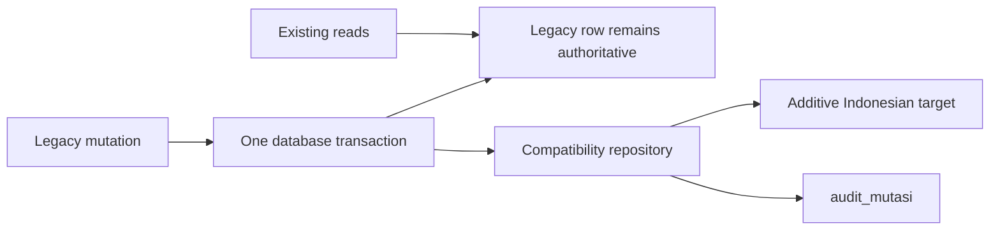

# Zyx Academy Architecture (vNext)

**Stack:** Next.js 16 (App Router), Drizzle ORM + SQLite (dev) / Turso (prod), Better-Auth, Gemini AI via Cloudflare AI Gateway, Pinecone + Cloudflare Vectorize (vector search), UploadThing / R2 (storage abstraction), Inngest (background jobs), Firebase Cloud Messaging (push notifs), Cloudflare Workers (vector API, realtime, diktat renderer)

---

## 1. Core Philosophy & 4-Layer Design

Every content asset exists in one of four layers, from source to student-facing product:

```
 Human Artifacts     ; Original PDFs in R2 (archival/student reference only)
 Canonical Content   ; Verified Markdown documents (source of truth)
 Structured Knowledge ; Derived objects (KOs, assessment objects, profiles, policies)
 AI Products         ; Compiled interactive assets (popovers, flashcards, quizzes, diktats)
```

- **Layer 1 ; Human Artifacts**: Original PDFs uploaded to Cloudflare R2 solely for archival and student reference. AI systems do not parse them directly.
- **Layer 2 ; Canonical Content**: Verified Markdown documents stored in Turso. Two types: *Learning Canonical* (`calculus_chapter_4.md`) and *Assessment Canonical* (`uts_2024.md`). These are the official academic sources of truth.
- **Layer 3 ; Structured Knowledge**: Automatically extracted from Canonical Content. Includes Knowledge Objects (concept graph, flashcards, Zyra context), Assessment Objects (structured questions, difficulty, patterns), Assessment Profiles (dynamic summary metrics), and Course Policies (static teacher-defined rules).
- **Layer 4 ; AI Products**: Compiled interactive assets served to students ; interactive popovers, flashcards, printable diktats, quiz questions.

---

## 2. Content Hierarchy (Core Domain)

```
Course (courses)
 └── Chapter (chapters) ; ordered by orderIndex
      ├── Knowledge Object (knowledge_objects) ; typed: definition|formula|example|misconception|exercise|summary|objective|concept_overview
      │    ├── has concept (concepts) via conceptId ; canonical cross-course concept
      │    │    └── localizations (concept_localizations) ; id/en display names + aliases
      │    ├── belongs to MTD (master_teaching_documents) via mtdId
      │    │    └── MTD has type: "learning" | "assessment"
      │    ├── feeds into → website_materials (compiled chapter material)
      │    ├── feeds into → ai_question_bank (questions tagged to KO)
      │    ├── feeds into → flashcards (per KO flashcards)
      │    ├── feeds into → knowledge_relationships (prerequisite/related/extends graph)
      │    ├── feeds into → vector_sync_queue (Pinecone/Vectorize sync)
      │    └── feeds into → learning_events (mastery tracking)
      ├── Website Material (website_materials) ; 1 per chapter, compiled from KOs
      │    └── Versions (website_material_versions) ; edit history
      ├── Flashcard Set (flashcard_sets) ; 1 per chapter, generated from KOs
      │    └── Flashcards (flashcards) ; individual front/back cards
      ├── Diktat (diktats) ; compiled PDF, references MTD
      ├── Student Progress (student_chapter_progress) ; per-student unlock/completion
      ├── AI Generation Job (ai_generation_jobs) ; tracks Gemini work
      └── Course Materials (course_materials) ; uploaded PDFs (materi_kelas / contoh_soal)

Assessment-specific (for type="assessment" MTDs):
 └── Assessment Object (assessment_objects) ; parsed from assessment canonical
      ├── questionType, difficulty, pattern, reasoningType, estimatedSteps
      ├── concepts (json array of concept references)
      └── feeds into → assessment_profiles (per-course rollup)
           └── course_policies (teacher-defined constraints)
```

### Key relations:

- **Course → Chapter → Knowledge Object (KO)**: The fundamental hierarchy. KOs are the atomic unit of knowledge.
- **Master Teaching Document (MTD)**: Source-of-truth with `type: "learning" | "assessment"`. Learning MTDs produce KOs; Assessment MTDs produce `assessment_objects`. Dual-hashing (`sourceHash`, `derivedHash`) tracks changes.
- **Chapter → Website Material**: Exactly one material per chapter, compiled from the chapter's KOs by Gemini.
- **Chapter → Flashcard Set**: Exactly one flashcard set per chapter, generated from KOs.
- **Concept** (canonical) ↔ **Concept Localizations** (id/en): A concept can span multiple courses/chapters. KOs reference concepts for cross-course mastery tracking.
- **Assessment Profile**: One per course, automatically computed from all `assessment_objects`. Drives quiz generation alongside `course_policies`.

---

## 3. Database Schema ; All Tables

### Auth Domain (Better-Auth)
| Table | Purpose |
|---|---|
| `user` | Better Auth users and temporary legacy `role` compatibility projection |
| `session` | Auth sessions |
| `account` | OAuth/password accounts |
| `verification` | Email verification tokens |
| `pengguna` | Canonical one-to-one domain identity for a Better Auth user |
| `peran` | Stable access-role catalog: `admin`, `tutor`, `murid` |
| `pengguna_peran` | Independent many-to-many identity membership with source and audit actor |

`FEATURE_PERAN_V2=1` makes the admin and tutor layout gates read `pengguna_peran`. The legacy `user.role` column remains during expand and rollback; it is not the canonical authorization source when the flag is enabled.

### Course & Enrollment
| Table | Purpose |
|---|---|
| `courses` | Course catalog ; title, category (enum of ~55 majors), description |
| `enrollments` | User→Course with expiry date (semester lock) |
| `groups` | Student groups (batch/class cohorts) |
| `group_members` | User→Group M:N |
| `enrollment_tokens` | Pre-generated tokens with capacity & expiry, bound to a group |
| `enrollment_token_courses` | Token→Course M:N (which courses the token unlocks) |

### Canonical Source and Idea Architecture

Plan 003 adds an additive Indonesian learning-domain layer. `mata_kuliah` and `bab` provide stable course and chapter identities while retaining legacy compatibility references. `sumber_materi` and `potongan_sumber` version canonical source content and exact source spans. `ide` is the future learning atom; it keeps stable identity, semantic and generation hashes, provenance policy, and no provider-specific vector ID.

| Table | Purpose |
|---|---|
| `mata_kuliah` | Stable course identity with legacy `courses` reference |
| `bab` | Stable ordered chapter identity with legacy `chapters` reference |
| `pendaftaran_murid` | Murid enrollment identity linked to `pengguna` and legacy enrollment |
| `penugasan_tutor` | Course tutor assignment with explicit scope and legacy assignment reference |
| `sumber_materi` | Versioned canonical source metadata and checksum |
| `potongan_sumber` | Exact source content spans, offsets, checksums, and embedding eligibility |
| `ide` | Course and chapter learning atom with optional global concept link |
| `asal_ide` | Idea to source-chunk provenance with exact offsets and source checksum |
| `relasi_ide` | Typed Idea relations with database self-edge protection and application cycle checks |
| `ketergantungan_produk` | Polymorphic downstream dependency freshness state |
| `peta_id_legacy` | Deterministic legacy-to-target identity mapping and checksums |

The existing `concepts` and `concept_localizations` tables remain the global cross-course concept registry. `FEATURE_ARSITEKTUR_IDE_V1` stays off until a later plan switches callers; existing KOs and source pipelines are not backfilled or rewritten here.

### Product, Assessment, and Mastery Architecture

Plan 004 adds the normalized Indonesian product and learner-state layer as empty additive tables. Existing English product, assessment, attempt, flashcard, learning-event, and mastery tables remain active; deterministic mapping and backfill are deferred to Plan 005.

| Domain | Target tables | Contract boundary |
|---|---|---|
| Products | `artikel`, `artikel_ide`, `blok_artikel`, `diktat_materi`, `diktat_ide`, `soal`, `soal_ide`, `soal_relasi_ide`, `pembahasan_soal`, `diktat_pembahasan`, `item_diktat_pembahasan` | Published products require published Idea links; question Idea weights are positive and validated to sum to one. |
| Protected references and flashcards | `soal_itb_referensi`, `benchmark_soal`, `set_flashcard`, `flashcard`, `flashcard_ide`, `kemajuan_flashcard_murid`, `review_flashcard` | Holdout references carry an explicit visibility state; review history is append-only by data model. |
| Assessments | `blueprint_asesmen`, `asesmen`, `cakupan_asesmen`, `item_asesmen`, `percobaan_asesmen`, `jawaban_murid` | Quiz scope is one chapter; tryout scope is one or more chapters; rendered content and grading snapshots are required. |
| Evidence and mastery | `bukti_ide_jawaban`, `bukti_pembelajaran`, `pemahaman_ide`, `perubahan_pemahaman`, `rekomendasi_flashcard` | Score and confidence remain separate; ambiguous evidence cannot affect mastery. |
| Bundle lifecycle | `impor_bundle`, `item_impor_bundle`, `review_bundle`, `publikasi_bundle`, `audit_mutasi` | Bundle identity is checksum-versioned and publication references an approved review. |

Plan 005 backfills the supported legacy shapes into these targets without deleting or rewriting source rows. Exact evidence is copied to target links; ambiguous questions, unattributable learning events, legacy concept baselines, and compatibility-only history are preserved in the exception ledger. `FEATURE_PRODUK_IDE_V1`, `FEATURE_ASESMEN_IDE_V1`, and `FEATURE_PEMAHAMAN_IDE_V1` remain absent or `0` in staging, and reads remain on the legacy tables.

### Legacy Backfill and Compatibility Boundary

The migration uses `lib/migrasi/backfill-engine.ts` in bounded transactions and records every source-to-target identity in `peta_id_legacy`. Rows that cannot be represented without inventing semantics are kept in `legacy_backfill_exceptions` with a source checksum, reason code, preservation path, and cutover blocking flag. A second apply is a read-and-compare operation for mapped rows and writes zero changed rows.

Current mutations remain legacy-first and are wrapped by one transaction when both `FEATURE_ARSITEKTUR_IDE_V1=1` and `FEATURE_DUAL_WRITE_IDE=1` are enabled:



The boundary covers material publication, flashcard review, quiz attempt start and submission, learning events with exact Idea identity, enrollment, tutor assignment, and Tutorial PKA progress. Target failures roll back the legacy mutation. With either flag disabled, the compatibility repository is a no-op and visible reads and writes stay on the legacy model.

Plan 005 staging evidence is stored at `artifacts/staging-overhaul/20260803-plan005-legacy-backfill/plan-005-result.json`.

### Tutor & Booking
| Table | Purpose |
|---|---|
| `tutor_courses` | Which courses a tutor can teach |
| `tutor_slots` | Weekly availability (dayOfWeek, startTime, endTime) |
| `bookings` | Student→Slot, unique per slot (FCFS) |

### Legacy Exams (pre-v4)
| Table | Purpose |
|---|---|
| `exams` | Quiz/tryout, draft/published/ended |
| `questions` | Per-exam questions (JSON blob approach) |
| `submissions` | Student exam submissions with snapshots |
| `progress` | Legacy material progress tracking |

### AI Content Ecosystem (vNext)

#### MTD & Extraction
| Table | Purpose |
|---|---|
| `master_teaching_documents` | Source-of-truth markdown, versioned, `type: learning|assessment`, `sourceHash`, `derivedHash`, status: draft/active/archived |
| `ai_extraction_failures` | Logs of failed Gemini extraction/canonicalization/validation steps |

#### Knowledge Architecture
| Table | Purpose |
|---|---|
| `knowledge_objects` | Atomic learning unit ; typed, bloom-leveled, difficulty, importance, linked to concept + MTD + chapter |
| `knowledge_relationships` | KO→KO edges: prerequisite, related, extends, example_of, misconception_of |
| `concepts` | Canonical cross-course concept registry (slug-based) |
| `concept_localizations` | id\|en display names + aliases + embeddings per concept |
| `concept_graph_edges` | Rollup: concept→concept edges for the graph visualization |

#### Assessment Architecture
| Table | Purpose |
|---|---|
| `assessment_objects` | Extracted assessment metadata per MTD: questionType, difficulty, applicationLevel, pattern, reasoningType, estimatedSteps, concepts |
| `assessment_profiles` | One per course: difficultyDistribution, commonPatterns, topContexts ; automatically computed from assessment_objects |
| `course_policies` | One per course: maxApplicationLevel, maxEstimatedSteps, forbiddenContexts, allowedPatterns ; teacher-defined |

#### Published Assets
| Table | Purpose |
|---|---|
| `website_materials` | Compiled chapter material ; canonicalMarkdown + structuredContent (AST JSON) + termIndex, generationHash, isStale, slug |
| `website_material_versions` | Edit history with author tracking |
| `flashcard_sets` | Per-chapter flashcard sets, hash-versioned, sourceMtdId, isStale |
| `flashcards` | Front/back/explanation, linked to KO |
| `diktats` | Compiled PDF study guides, Puppeteer-generated, hash-versioned |
| `course_materials` | Uploaded PDFs (materi_kelas / contoh_soal), linked to chapters |

#### AI Generation
| Table | Purpose |
|---|---|
| `ai_material_instances` | Legacy material metadata (pre-v4, deprecated in favor of KO flow) |
| `ai_material_instance_sections` | Legacy sections |
| `ai_material_instance_chunks` | Legacy text chunks for Pinecone |
| `ai_generation_jobs` | Tracks Gemini generation: pending→processing→completed→failed, token counts |
| `ai_question_bank` | Permanent question repository: linked to KO/MTD with generationHash, distractorMap, bloomLevel, pattern, estimatedSteps, isStale |
| `question_option_stats` | Per-option selection counters for distractor analytics |
| `ai_usage_events` | Token usage per user per feature per model |
| `ai_generation_traces` | Privacy-safe AI execution provenance traces (hashes, versions, tokens, violations, latency, terminal outcome) |

#### Quiz System
| Table | Purpose |
|---|---|
| `quiz_templates` | Quiz config: selection rules (difficulty mix, tag filters), time limits, category (daily/weekly/chapter/premium) |
| `student_quiz_attempts` | Per-student quiz session with deep question/answer snapshots, masteryBefore snapshot, strong/weak areas |
| `attempt_feedback` | Per-question feedback payloads |
| `live_quiz_sessions` | Real-time tutor-led quiz (code, state: lobby→question→reveal→ended) |
| `live_quiz_results` | Per-student results for live quizzes |

#### Vector Sync
| Table | Purpose |
|---|---|
| `vector_sync_queue` | Transactional outbox for Pinecone/Vectorize sync ; upsert/delete, retry with backoff, namespace field for multi-index routing |

#### Mastery & Analytics
| Table | Purpose |
|---|---|
| `learning_events` | Append-only event log: quiz_answer, flashcard_review, material_completed, tutor_question |
| `student_concept_mastery` | Per (student, course, concept) mastery score + confidence + trend |
| `student_concept_mastery_history` | Daily snapshots for trend computation |
| `student_streaks` | Current/longest streak tracking |
| `daily_recommendations` | Per-student daily payload with completed items tracking |
| `tutor_session_summaries` | Aggregated per (student, course) tutor chat context |
| `tutor_chat_messages` | Per-message history (capped at 100 per student×course) |
| `study_paths` | Personalized study path JSON |
| `course_analytics_snapshots` | Daily per-course pre-computed analytics |
| `student_flashcard_progress` | SM-2 spaced repetition per (student, flashcard) |
| `interventions` | Active intervention flags per student×concept |
| `weekly_reflections` | Weekly learning reflection payloads |

#### Concept Graph (Assessment EIF E5)
| Table | Purpose |
|---|---|
| `concept_graph_edges` | Concept-level prerequisite/related graph edges |

#### Mastery Recompute
| Table | Purpose |
|---|---|
| `mastery_recompute_queue` | Async mastery recomputation queue |

#### Learning Outcomes (Accreditation)
| Table | Purpose |
|---|---|
| `learning_outcomes` | CPL/CPMK/Sub-CPMK hierarchy |
| `learning_outcome_concepts` | Outcome to concept mapping |

#### Career Paths
| Table | Purpose |
|---|---|
| `career_path_templates` | Career-oriented learning path templates |
| `career_path_concepts` | Career path to concept mapping |

#### PKA Campaign
| Table | Purpose |
|---|---|
| `pka_simulation_stages` | Subject/stage to quiz mapping (matematika, fisika, kimia) |
| `pka_stage_progress` | Per-student PKA stage gating state |
| `pka_announcements` | Admin broadcast announcements |
| `pka_schedules` | Google Meet review session schedules |
| `pka_registrations` | Gated enrollment intake form |

#### Content Quality
| Table | Purpose |
|---|---|
| `content_quality_flags` | Auto-detected quality flags: too_easy, too_hard, dead_distractor |

#### Blog & Short Links
| Table | Purpose |
|---|---|
| `blog_articles` | Blog system (tips_kuliah, pojok_kampus, fakta_seru, kegiatan_zyx) |
| `short_link` | URL shortener (zyxacademy.com/s/[slug]) |
| `page_analytics` | GA4 popular pages cache |

#### Admin Drive
| Table | Purpose |
|---|---|
| `drive_item` | Folder tree + file pointers (folder\|file, uploadthingKey, ufsUrl, mimeType, sizeBytes) |

#### Push Notifications
| Table | Purpose |
|---|---|
| `user_push_tokens` | FCM device tokens per user |
| `notifications` | In-app notification log (quiz_published, flashcard_reminder, tutor_reminder, etc.) |

---

## 4. Upload & Ingestion Pipeline (vNext)

```
Upload PDF via UploadThing or direct R2
  │
  ├──→ Admin Drive (/admin/files) ; Google-Drive-style folder tree
  │
  ├──→ Create Master Teaching Document (MTD)
  │    ├── Select type: "learning" or "assessment"
  │    ├── Upload markdown content
  │    └── Pre-ingestion canonical validation (lib/canonical-validator.ts)
  │         ├── Validates heading hierarchy
  │         ├── Checks custom container syntax
  │         ├── Validates KaTeX compilation
  │         └── Fails early if structure is malformed
  │
  ├── type="learning" → KO Extraction Pipeline (lib/ko-extractor.ts, V2: FEATURE_KO_PIPELINE_V2, lib/knowledge/*)
  │    ├── Stage 1: Source normalization & hashing (`lib/knowledge/chunker.ts`)
  │    ├── Stage 2: Deterministic semantic chunking preserving math, code, tables & headings without 30k char truncation
  │    ├── Stage 3: Per-chunk candidate KO & Learning Objective extraction (`lib/knowledge/candidate-extractor.ts`)
  │    ├── Stage 4: Cross-chunk deduplication preserving all source spans (`lib/knowledge/candidate-reconciler.ts`)
  │    ├── Stage 5: Canonical resolution checking exact names, aliases & flagging high embedding similarity as ambiguous (`lib/knowledge/canonicalizer.ts`)
  │    ├── Stage 6: Deterministic validation & run state assignment (`staged`, `accepted`, `needs_review`, `failed`) (`lib/knowledge/extraction-run.ts`)
  │    ├── Stage 7: Atomic accepted-run persistence using stable identity keys (`lib/knowledge/identity.ts`)
  │    ├── Source spans tracked in `knowledge_object_sources` & cognitive objectives in `learning_objectives`
  │    ├── Concept resolution (`concepts` / `concept_localizations`)
  │    ├── `vector_sync_queue` populated (namespace: "learning")
  │    └── Inngest background job syncs to Pinecone "learning" index
  │
  └── type="assessment" → Assessment Extraction Pipeline (lib/assessment-extractor.ts)
       ├── Deterministic split on H2 headings → question blocks
       ├── Gemini classifies each block (questionType, difficulty, pattern, etc.)
       ├── Computes sourceHash + derivedHash
       ├── Writes assessment_objects rows
       ├── Updates assessment_profiles rollup for the course
       └── vector_sync_queue populated (namespace: "assessment")

Storage Services (abstracted via lib/storage/index.ts):
 ─ UploadThing: Browser file upload (dev fallback)
 ─ R2 (@aws-sdk/client-s3): Production object storage
 ─ STORAGE_PROVIDER_MODE env var controls routing
```

---

## 5. AI Generation Pipeline

### A. Question Generation (Pedagogical Pipeline)
```
Tutor clicks "Generate Questions" (/admin/ai/questions)
  → startGenerationJob() in generation-pipeline.ts
      ├── Creates question_generation_runs audit record (status: processing)
      ├── Blueprint Engine (lib/questions/blueprint.ts)
      │    └── Produces per-slot specs: KO ID, learning objective, cognitive process, target difficulty, reasoning pattern, targeted misconceptions
      ├── Gemini generates draft candidate options with stable option IDs (opt_0..opt_3)
      ├── Application Option Shuffle (lib/questions/option-shuffle.ts)
      │    └── Shuffles options deterministically with seed; recomputes correctIndices and stable IDs
      ├── Distractor Provenance Engine (lib/questions/distractor-provenance.ts)
      │    └── Maps non-correct options with targeted misconception family, method, score, and uncertainty state
      ├── Validation & Policy Gates (lib/question-validator.ts, lib/pedagogical-validator.ts)
      │    ├── Checks KaTeX syntax, duplicate options, and position leakage phrases
      │    ├── Checks forbiddenContexts, maxApplicationLevel, maxEstimatedSteps, allowedPatterns
      │    └── Rejects non-compliant questions
      ├── Inserts into ai_question_bank (status: generated, qualityScore: null [unverified], generationRunId linked)
      ├── Inserts into distractor_provenance table
      └── Updates question_generation_runs status: completed / partial / failed
```

### B. Website Material Generation
```
Tutor clicks "Generate Material" (for a chapter)
  → generateMarkdownForChapter() in material-generator.ts
      ├── Fetches course + chapter + all active KOs ordered by learningOrder
      ├── buildMaterialGenerationPrompt() → constructs Gemini prompt
      │    └── Precise custom markdown containers: :::learning_objective, :::concept, :::formula, :::example, :::misconception
      ├── Gemini returns canonical markdown
      ├── saveWebsiteMaterial() in material-storage.ts
      │    ├── compileMarkdownToAST() → parses custom containers into structured AST
      │    ├── validateAST() → Zod validation of AST structure
      │    ├── buildTermIndex() → extracts terms for interactive popover
      │    ├── buildConceptGraph() → concept graph edges
      │    ├── Writes website_materials row with generationHash
      │    └── Writes website_material_versions row
      └── Website material appears in course portal
```

### C. Flashcard Generation
```
Tutor generates flashcards per chapter
  → generateFlashcardsForChapter() in flashcard-generator.ts
      ├── Fetches KOs for the chapter
      ├── Gemini generates front/back/explanation for each KO
      ├── Creates flashcard_sets + flashcards rows (generationHash, sourceMtdId)
      └── Students review via SM-2 scheduler (student_flashcard_progress)
```

### D. Diktat (PDF) Generation
```
Tutor compiles diktat in /admin/ai/diktats
  → diktat-generator.ts
      ├── Fetches MTD content + chapter selections
      ├── Puppeteer renders markdown → PDF (via Railway service: DIKTAT_RENDERER_URL)
      ├── Uploads to R2 (via lib/storage)
      └── Creates diktats row with fileUrl, generationHash
```

### E. Vector Sync (Pinecone / Vectorize)
```
Any KO or assessment_objects create/update → vector_sync_queue row (namespace: "learning"|"assessment")
  → Inngest background function (vectorSyncWorker) processes batches:
      ├── Fetch pending queue items per namespace (batch size: configurable, default 50)
      ├── embedTexts() via Gemini text-embedding-004
      ├── Upsert to vector store (Pinecone by default, VECTOR_STORE env controls mode)
      │    └── VECTOR_STORE = "pinecone" | "dual" | "vectorize"
      ├── Namespace per course: course_{courseId}_{namespace}
      ├── Optional mirror to Cloudflare Vectorize (dual mode)
      └── Mark queue completed, update KO pineconeVectorId
```

---

## 6. Student Learning Flow

```
Student redeems enrollment token
  → group_members + enrollments created
  → Dashboard (/dashboard) shows:
     ├── Active classes with progress bars
     ├── Daily recommendations (daily_recommendations)
     ├── Weak concepts (student_concept_mastery)
     ├── Streak info (student_streaks)
     └── Quick links to materials/quizzes/flashcards

  → Course Portal (/courses/[id]):
     ├── Material viewer ; renders website_materials (markdown + AST)
     │    └── Interactive popover on terms (termIndex → concept lookup)
     ├── Quiz player ; selects questions from ai_question_bank via quiz_templates.selectionRules
     │    ├── Creates student_quiz_attempts with question snapshot + masteryBefore
     │    ├── API answer redaction: GET /api/quiz/attempts & GET /api/quiz/attempts/[id] redact correct_indices & stored explanations during in_progress attempts
     │    ├── Auto-grades MC, flags essays as pending_review
     │    ├── Records learning_events for mastery update
     │    └── Shows results with mistake feedback (attempt_feedback)
     ├── Tryout ; timed exam mode
     ├── Flashcards ; SM-2 spaced repetition (student_flashcard_progress)
     ├── Live quiz ; join via code, real-time leaderboard (WebSocket/SSE via zyxrealtime Worker)
     ├── AI Tutor ; Gemini chat with RAG (Pinecone vector search), Query Action Router (`lib/tutor/query-action.ts`), and Tier 1 Cache Isolation (`lib/tutor/cache-contract.ts`)
     │    ├── Typed Query Actions: `retrieve`, `reuse_previous_evidence`, `answer_from_conversation`, `clarify`
     │    ├── Style modifier extraction (`simpler`, `analogy`, `worked_example`, `graph`, `flowchart`, etc.) applied post-retrieval
     │    ├── Student-free Tier 1 shared KV payload: zero student ID, session ID, or history in cached data (`assertNoStudentTextInSharedCache`)
     │    ├── Deterministic cache keys: incorporates academic content query hash, prompt version, policy version, schema version, and `evidenceVersion` digest
     │    └── Governed by Assessment Assistance Policy (`lib/assessment-assistance-policy.ts`) ; forbids direct answer reveals during active attempts
     ├── Tutor Booking ; book slots from tutor_slots
     ├── Leaderboard ; per-course ranking
     └── My Results ; attempt history + mastery graph

Mastery System (background, Inngest cron):
  learning_events → student_concept_mastery recomputed
  → student_concept_mastery_history (daily snapshots)
  → interventions (if mastery drops)
  → daily_recommendations (personalized next steps)
  → study_paths (personalized learning path)
  → weekly_reflections (weekly summary via Gemini)
```

---

## 7. Key Services Integration

| Service | Usage |
|---|---|
| **Next.js 16** | App Router, Server Actions, React Server Components |
| **Drizzle ORM** | SQLite (dev via `file:dev.db`) / Turso (prod via `@libsql/client`), schema in `db/schema.ts` |
| **Better-Auth** | Auth: credentials + Google OAuth, role-based (admin/teacher/student) |
| **Gemini** (`@google/genai`) | Text generation: material, flashcards, questions, assessment classification, AI tutor, embeddings (text-embedding-004) |
| **Cloudflare AI Gateway** | All Gemini requests routed through gateway for caching, rate limiting, observability |
| **Pinecone** | Primary vector store for KO + assessment embeddings, namespace per course × type (`course_{courseId}_learning` / `course_{courseId}_assessment`), RAG for AI tutor |
| **Cloudflare Vectorize** | Secondary/migration vector store. `VECTOR_STORE` env controls mode: `pinecone` (default), `dual` (write both), or `vectorize` (read from VZ) |
| **Cloudflare R2** | S3-compatible object storage for diktat PDFs, long-term assets, course materials (via `lib/storage/index.ts`) |
| **Cloudflare KV** | AI response cache (used by AI tutor for repeated questions) |
| **Cloudflare Workers** | Three dedicated Workers: `zyx-vector-api` (Vectorize proxy), `zyxrealtime` (live quiz WebSocket/SSE), `zyxacademydiktat` (Puppeteer PDF, hosted on Railway) |
| **UploadThing** | Browser file uploads (dev fallback); production prefers direct R2 via storage abstraction |
| **Inngest** | Background job orchestration: vector sync (learning + assessment namespaces), generation pipelines, mastery recompute, assessment ingest, analytics snapshots, weekly reflections |
| **Firebase Admin** | FCM push notifications |
| **Puppeteer** | PDF generation for diktats (runs as separate Railway service at `DIKTAT_RENDERER_URL`) |
| **Resend** | Transactional emails |
| **Sentry** | Error tracking |

---

## 8. Directory Map

```
app/
├── courses/[id]/        ; Course portal (material, quiz, tryout, flashcard, live, mastery, path, leaderboard, my-results)
├── dashboard/           ; Student hub (active classes, weak concepts, recommendations)
├── admin/
│   ├── ai/              ; AI generation: materials, questions, quizzes, diktats, distractors, jobs, keys, analytics
│   ├── courses/         ; Course CRUD
│   ├── files/           ; UploadThing drive explorer
│   └── tokens/          ; Enrollment token management
├── api/
│   ├── uploadthing/     ; UploadThing route handler
│   ├── inngest/         ; Inngest serve endpoint
│   ├── admin/           ; Admin API routes (materials, canonical validation, type selection)
│   ├── quiz/            ; Quiz submission endpoints
│   └── storage/         ; R2 signed URLs
├── about/               ; About page
├── plans/               ; Pricing plans
├── testimonial/         ; Testimonials
├── profile/             ; User profile
├── settings/            ; User settings
├── tutor/               ; Tutor portal
└── feedback/            ; Feedback forms

lib/
├── db/                  ; Database client & schema
├── ai/                  ; AI utilities & analytics
├── storage/             ; Storage abstraction (UploadThing + R2 providers)

├── (AI Core)
│   ├── gemini.ts                ; Gemini provider (generateContentWithFallback, embedText)
│   ├── ai-router.ts             ; Use-case → model routing with fallback chains
│   ├── canonical-validator.ts   ; Pre-ingestion markdown structure validation (vNext)
│   ├── assessment-extractor.ts  ; Assessment MTD parsing & classification (vNext)
│   ├── pedagogical-validator.ts ; Policy-guarded question validation (vNext)
│   ├── question-blueprint-engine.ts ; Per-KO blueprint generation (vNext)
│   ├── question-validator.ts    ; Structural validation of generated questions
│   ├── distractor-mapper.ts     ; Maps wrong options to misconception KOs
│   ├── generation-pipeline.ts   ; Question generation orchestration
│   ├── ko-extractor.ts          ; KO extraction from learning-type MTDs
│   ├── ko-utils.ts              ; Shared utilities (repairJson, slugify, etc.)
│   ├── material-generator.ts    ; Website material generation (Gemini → markdown)
│   ├── material-storage.ts      ; Save compiled material + AST + versioning
│   ├── flashcard-generator.ts   ; Flashcard generation
│   ├── question-generator.ts    ; Question generation + validation
│   ├── diktat-generator.ts      ; PDF compilation via Puppeteer
│   ├── ingestion-parser.ts      ; Markdown → sections → chunks
│   ├── markdown-compiler.ts     ; Custom markdown → AST parser
│   ├── ast-validator.ts         ; Zod AST validation
│   ├── term-index.ts            ; Build interactive term index
│   ├── graph-trace.ts           ; Concept graph construction
│   └── tutor/                   ; V2 Tutor Pipeline
│       ├── cache-contract.ts    ; Student-free Tier 1 shared KV cache key & assertion contract
│       └── query-action.ts      ; Deterministic & AI follow-up Query Action Router

├── (Vector & Search)
│   ├── vector-store.ts          ; Store abstraction (Pinecone / Vectorize / dual)
│   ├── pinecone.ts              ; Pinecone client driver
│   ├── vectorize-client.ts      ; Cloudflare Vectorize client
│   └── context-assembly.ts      ; RAG context assembly for AI tutor

├── (Jobs)
│   ├── inngest.ts               ; Inngest client
│   └── inngest-functions.ts     ; Background job handlers (vector sync, assessment ingest, mastery, etc.)

├── (Learning Analytics)
│   ├── mastery-store.ts         ; Mastery score computation
│   ├── learner-profile.ts       ; Student profile aggregation
│   ├── recommendation-service.ts ; Daily recommendations
│   ├── intervention-service.ts  ; Intervention generation
│   ├── mistake-feedback.ts      ; Per-question mistake analysis
│   ├── reflection-service.ts    ; Weekly reflection generation
│   ├── streak-service.ts        ; Streak computation
│   ├── study-path-service.ts    ; Personalized study paths
│   └── cohort-analytics.ts      ; Cohort-level analytics

├── (Infrastructure)
│   ├── drive.ts                 ; Admin drive folder/file operations
│   ├── uploadthing.ts           ; UploadThing client components
│   ├── kv-cache.ts              ; KV cache wrapper
│   ├── env.ts                   ; Environment variables & feature flags
│   ├── auth.ts / auth-client.ts / auth-redirect.ts ; Auth helpers
│   ├── pubic-app-url.ts         ; Public URL helper
│   └── whatsapp-admin.ts        ; WhatsApp admin notifications
├── notifications/
│   └── jobs.ts                  ; Push notification job logic
└── site.ts, site-search.ts, testimonials.ts, youtube.ts ; Static content
```

---

## 9. Production Deployment Architecture

```
                    ┌─────────────────────────┐
                    │      Vercel (Next.js)     │
                    │  zyx-edu.vercel.app       │
                    │                           │
                    │  App Router + Server      │
                    │  Actions + API routes     │
                    └─────┬──────┬──────┬───────┘
                          │      │      │
          ┌───────────────┘      │      └───────────────┐
          ▼                      ▼                      ▼
   ┌──────────────┐    ┌────────────────┐    ┌──────────────────┐
   │  Turso DB     │    │  Cloudflare R2 │    │   Inngest Cloud  │
   │  (libsql)     │    │  (S3 API)      │    │  (bg jobs)       │
   │  zyx.soezyx.. │    │  zyx bucket    │    │                  │
   └──────────────┘    └────────────────┘    └────────┬─────────┘
                                                      │
                                                      ▼
                                          ┌─────────────────────┐
                                          │  Gemini AI (Google)  │
                                          │  via Cloudflare AI   │
                                          │  Gateway (caching)   │
                                          └──────────┬──────────┘
                                                     │
                          ┌──────────────────────────┼──────────┐
                          ▼                          ▼          ▼
               ┌──────────────────┐    ┌────────────────────┐
               │ Pinecone (vector) │    │ CF Vectorize (vec) │
               │  or               │    │  via zyx-vector-api│
               │  VECTOR_STORE=dual│    │  Worker            │
               │  namespaces:      │    └────────────────────┘
               │  learning/assess  │
               └──────────────────┘

Cloudflare Workers (deployed via wrangler):
  ├── zyx-vector-api     ; Vectorize upsert/query/delete proxy
  ├── zyxrealtime         ; Live quiz WebSocket/SSE server
  └── zyxacademydiktat    ; Puppeteer PDF renderer (hosted on Railway)
```

### Key Production Differences from Dev

| Aspect | Development | Production |
|---|---|---|
| **Database** | SQLite file (`dev.db`) | Turso (libsql, distributed SQLite) |
| **Object Storage** | UploadThing (default) | R2 via `lib/storage/index.ts` (`STORAGE_PROVIDER_MODE`) |
| **Vector Store** | Pinecone | `VECTOR_STORE` env: `pinecone` (default), `dual`, `vectorize` |
| **AI Gateway** | Direct Gemini API | Cloudflare AI Gateway (rate limit, caching, observability) |
| **Auth URL** | `localhost:3000` | `BETTER_AUTH_URL` = production origin |
| **Diktat Renderer** | Mock PDF | Railway Puppeteer service at `DIKTAT_RENDERER_URL` |
| **Analytics** | None | Vercel Analytics + Speed Insights + Sentry |

### Feature Flags (env `FEATURE_*`)
Gradual rollout via env vars ; all default to off unless set to `"1"`:
```
FEATURE_MASTERY, FEATURE_TODAY, FEATURE_EMBED, FEATURE_MISCONCEPTION,
FEATURE_REMEDIATION, FEATURE_MATERIAL_LIVE, FEATURE_FC_DIFFICULTY,
FEATURE_GRAPH, FEATURE_TUTOR_RAG, FEATURE_FEEDBACK, FEATURE_STUDY_PATH,
FEATURE_TUTOR_ANALYTICS, FEATURE_LIVE, FEATURE_REFLECTION,
FEATURE_REFLECTION_EMAIL, FEATURE_ADAPTIVE_QUIZ, FEATURE_PKA
```

---

## 10. Data Flow Diagrams

### Content Creation Flow (Admin/Teacher)

```
Upload PDF/Markdown
   │
   ├──→ Admin Drive (drive_item table)
   │
   └──→ Create MTD (type: "learning" | "assessment")
         │
         ├── Canonical Validation (canonical-validator.ts)
         │    └── Fails fast if structure invalid
         │
         ├── type="learning":
         │    ├──→ KO Extraction (Gemini → knowledge_objects)
         │    │      ├──→ Generate Website Material (Gemini → markdown → AST → website_materials)
         │    │      ├──→ Generate Flashcards (Gemini → flashcard_sets → flashcards)
         │    │      ├──→ Generate Questions (Gemini + Blueprint Engine + Pedagogical Validator → ai_question_bank)
         │    │      ├──→ Generate Diktat PDF (Puppeteer → R2)
         │    │      └──→ Vector Sync (Inngest → Pinecone, namespace: "learning")
         │
         └── type="assessment":
              └──→ Assessment Extraction (Deterministic split + Gemini classification)
                     ├──→ assessment_objects + assessment_profiles
                     └──→ Vector Sync (Inngest → Pinecone, namespace: "assessment")
```

### Student Interaction Flow

```
Student
  ├── Views Material → renders website_materials (markdown + AST + term popover)
  ├── Takes Quiz → quiz_templates × assessment_profile × course_policies → ai_question_bank
  │                  → student_quiz_attempts → learning_events
  │                  → mastery recompute → daily_recommendations update
  ├── Reviews Flashcards → SM-2 scheduler → student_flashcard_progress
  ├── AI Tutor Chat → tutor-rag.ts (Pinecone similarity search, "learning" namespace)
  │                    → tutor_chat_messages → tutor_session_summaries
  └── Live Quiz → WebSocket/SSE (zyxrealtime Worker) → live_quiz_sessions → live_quiz_results
```

---

## 11. Dual-Hashing & Staleness

All derived assets (website_materials, flashcard_sets, diktats, ai_question_bank) track their source MTD version via a dual-hashing system:

1. **`sourceHash`**: SHA-256 of the raw MTD markdown content. Changes when the source document is edited.

2. **`derivedHash`**: SHA-256 of active KOs' key attributes (for learning) or sorted question blocks (for assessment). Only changes when structured content actually shifts.

3. **Staleness cascade**: When MTD content changes:
   - `sourceHash` and `derivedHash` are recomputed
   - If `derivedHash` matches previous value → no regeneration needed (cosmetic edit only)
   - If `derivedHash` differs → downstream assets flagged `isStale = true`
   - `sourceMtdVersion` tracks which MTD version was used for each asset

This dual approach prevents unnecessary regeneration (e.g., fixing a typo in a paragraph does not invalidate flashcards derived from the same KOs).
