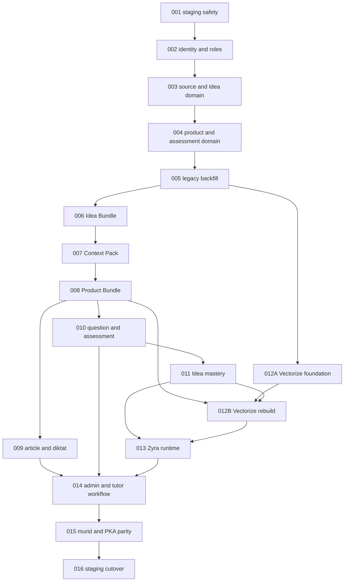

# Zyx Idea-Centered Learning System Overhaul

Status program: in progress, Plans 001 through 005 are complete and Plan 006 is ready to start.

Planning snapshot:

- Repository: `D:\ZYX\zyx-web`
- Branch inspected: `staging`
- Source commit inspected: `03b68ba0e66ee90f41fe92886b15f81a7a36ec3c`
- Planning date: 2026-08-02
- Target environment: staging resources loaded only from `.env.staging`
- Production deployment: out of scope

The former Plans 001 through 015 were intentionally removed after execution. Do not restore or mix them with this series. These plans start a new program and must be executed from their recorded predecessor commit.

## Non-negotiable program invariants

1. Existing database records, immutable attempt snapshots, user identities, enrollments, Tutorial PKA progress, and historical analytics must remain queryable and operational.
2. Use expand, backfill, verify, switch, then contract. An export is a recovery and reconciliation artifact, not the primary migration mechanism.
3. Every remote command must load `.env.staging`, pass the staging identity guard, and refuse to run when a staging resource equals or resembles a production resource.
4. Never print secrets or full authenticated URLs. Never use `db:sync-prod-to-staging` during this overhaul.
5. Edit `db/schema.ts`, then run `bun run db:generate`; never hand-edit generated files under `drizzle/`.
6. All new behavior remains invisible when its `FEATURE_*` flag is absent or `0`.
7. Database and domain naming for access roles uses `admin`, `tutor`, and `murid`. Do not blindly replace message roles such as AI chat speakers.
8. `ide` replaces `knowledge_objects` as the canonical learning atom. `concepts` remains the global cross-course concept registry.
9. Turso remains the source of truth. Vectorize stores searchable representations and IDs only. Pinecone is removed only in Plan 016 after a verified Vectorize-only cutover.
10. Each plan must pass lint, targeted tests, typecheck, its staging gates, and `git diff --check` before the next plan starts.
11. Do not run `bun run build` unless a plan explicitly requires it or the change is breaking under `AGENTS.md`.
12. Stop immediately on count loss, checksum mismatch, orphaned rows, unexpected production identity, non-idempotent re-run, or a failed rollback rehearsal.

## Execution order and status

Execute sequentially. A plan is a predecessor gate, not optional reading.

| Plan | Title | Priority | Effort | Depends on | Status | Main exit gate |
|---|---|---|---|---|---|---|
| [001](001-staging-safety-and-migration-ledger.md) | Staging safety and migration ledger | P0 | M | None | DONE | Safe staging commands, complete inventory and export, rollback rehearsal |
| [002](002-indonesian-identity-and-role-expansion.md) | Indonesian identity and role expansion | P0 | L | 001 | DONE | Every user has equivalent `admin`, `tutor`, or `murid` membership |
| [003](003-source-and-idea-domain-expansion.md) | Source and Idea domain expansion | P0 | L | 002 | DONE | All target source, Idea, provenance, relation, and dependency tables exist |
| [004](004-product-assessment-and-mastery-domain-expansion.md) | Product, assessment, and mastery domain expansion | P0 | L | 003 | DONE | Target product and learner tables exist with enforced invariants |
| [005](005-deterministic-legacy-backfill-and-compatibility.md) | Deterministic legacy backfill and compatibility layer | P0 | L | 004 | DONE | 100 percent legacy mapping or an explicit zero-loss exception ledger |
| [006](006-idea-bundle-v2-workflow.md) | Idea Bundle V2 workflow | P1 | L | 005 | TODO | ZIP import is validated, idempotent, reviewed, and atomically published |
| [007](007-authoring-context-pack-and-protected-benchmarks.md) | Authoring Context Pack and protected benchmarks | P1 | M | 006 | TODO | Context export excludes holdout content and is reproducible |
| [008](008-product-bundle-v2-workflow.md) | Product Bundle V2 workflow | P1 | L | 007 | TODO | Product import, preview, review, and publish are atomic and dependency-aware |
| [009](009-article-and-diktat-quality-compiler.md) | Article and diktat quality compiler | P1 | L | 008 | TODO | Required pedagogic blocks and source coverage pass publication gates |
| [010](010-question-and-assessment-integrity.md) | Question and assessment integrity | P0 | L | 008 | TODO | Multi-Idea evidence, blueprint, benchmark, and active-attempt gates pass |
| [011](011-per-idea-mastery-and-learning-loop.md) | Per-Idea mastery and learning loop | P0 | L | 010 | TODO | Mastery and confidence are separate, reproducible, and history-safe |
| [012](012-vectorize-only-indexing-and-retrieval.md) | Vectorize-only indexing and retrieval | P0 | L | 005, 011; internal foundation after 005 | TODO | DB and Vectorize manifests match exactly in staging |
| [013](013-zyra-canonical-runtime.md) | Zyra canonical runtime | P1 | L | 011, 012 | TODO | Responses hydrate approved DB content and assessment leaks are zero |
| [014](014-admin-and-tutor-operational-workflow.md) | Admin and tutor operational workflow | P1 | L | 009, 010, 013 | TODO | Admin and tutor can complete the new content lifecycle end to end |
| [015](015-murid-workflow-and-tutorial-pka-parity.md) | Murid workflow and Tutorial PKA parity | P0 | L | 014 | TODO | Existing Tutorial PKA history and all core murid journeys remain operational |
| [016](016-staging-cutover-pinecone-removal-and-legacy-contract.md) | Staging cutover, Pinecone removal, and legacy contract | P0 | L | 015 | TODO | Two clean rehearsals, rollback pass, zero active legacy write callers |

Status values: `TODO`, `IN PROGRESS`, `DONE`, `BLOCKED`, or `REJECTED`. `BLOCKED` and `REJECTED` require a one-line reason.

Plan 002 evidence: `artifacts/staging-overhaul/20260802-plan002-staging/plan-002-result.json` records passed staging parity, idempotent rerun, seed, and four-case auth smoke. `FEATURE_PERAN_V2` remains `0` in staging pending the next plan's integration gates.

Plan 003 evidence: `artifacts/staging-overhaul/20260802-plan003-staging/plan-003-result.json` records 11 additive target tables, unchanged legacy row and key manifests, zero foreign-key violations, and `FEATURE_ARSITEKTUR_IDE_V1` absent or off.

Plan 004 evidence: `artifacts/staging-overhaul/20260802-plan004-staging/plan-004-result.json` records 34 additive target tables, unchanged legacy row and key manifests, zero foreign-key violations, and all three Plan 004 feature flags absent or off.

Plan 005 evidence: `artifacts/staging-overhaul/20260803-plan005-legacy-backfill/plan-005-result.json` records 568 deterministic mappings, 3,175 zero-loss exception rows, zero blocking exceptions, zero foreign-key violations, zero uncovered rows, zero snapshot mismatches, zero Tutorial PKA mismatches, and an idempotent apply with `changedRows: 0`.

## Serialized integration graph

The numbered table preserves the program gates. Implementation lanes may run in parallel only when their write sets are disjoint. Integration, staging writes, migrations, shared files, feature flags, and evidence status remain serial.

Wave ownership is one writer per schema or documentation hotspot. Plan 001 through 005 and Plan 015 through 016 are serial. Plans 009 and 010 may develop in parallel after Plan 008. Plan 012 foundation may develop after Plan 005, but its final rebuild waits for Plan 011. Only the root executor may mutate staging resources or confirm final cutover.

## Dependency notes

- Plans 001 through 005 establish safety, additive schema, and deterministic preservation before any workflow switches.
- Plans 006 through 010 build the authoring, product, and assessment chain on the preserved target domain.
- Plans 011 through 013 require attributable evidence and exact Vectorize reconciliation before the new Zyra runtime is enabled.
- Plans 014 and 015 switch human workflows only after domain and runtime gates pass.
- Plan 016 is the only plan allowed to remove Pinecone code or stop legacy writes.

## Findings considered and rejected

- Broad product audit: intentionally rejected for this run because the user selected a focused system overhaul and asked to avoid expanding the scope.
- Destructive export, rebuild, and import as the primary migration: rejected because additive migration with deterministic backfill gives stronger rollback and data-preservation guarantees.
- Immediate legacy-table deletion: rejected because historical data must remain operational and staging soak evidence does not justify destructive contraction.

## Shared completion evidence

Each plan must create `artifacts/staging-overhaul/<runId>/plan-NNN-result.json` through a script, not by manually typing evidence. The result must contain the source commit, migration run ID, masked resource fingerprints, commands and exit codes, row counts, reconciliation hashes, feature flag state, rollback result, and operator timestamp. The artifact directory must be ignored by Git.

No plan may mark itself complete from prose alone. Update this index status only after the evidence file exists and all plan-specific gates pass.
