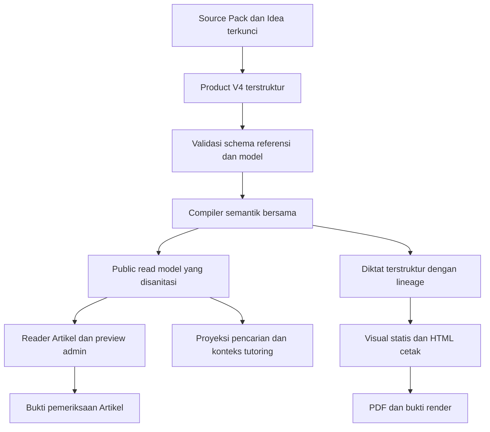

# Rancangan sistem Artikel dan Diktat Zyx

Status: `OPEN / IN PROGRESS`

Tanggal: 2026-10-21. Tahap: usulan arsitektur untuk dibahas, belum implementasi. Pemilik keputusan produk dan rollout: operator Zyx. Penanggung jawab teknis yang diusulkan: maintainer authoring, reader, dan compute sesuai area perubahan.

Artikel menjadi bacaan yang menyatukan penjelasan, rumus, syarat, contoh, serta visual dalam urutan belajar yang jelas. Diktat mempertahankan hubungan penting itu dalam ringkasan untuk mengulang materi. Sistem authoring membantu agent memilih representasi yang tepat dan meminta bukti terhadap artifact final sebelum dinyatakan siap dipublikasikan.

Dokumen ini menetapkan target representasi, pilihan library, kontrak visual dan aset, compiler, metode agent, verifikasi MCP, distribusi skills, serta transisi konten lama. Semua nama schema, field, tool baru, dan batas komputasi yang disebut sebagai usulan belum merupakan API aktif. Dokumen kontrak V3 tetap berlaku sampai transisi disetujui dan dijalankan.

## 1. Keputusan rancangan utama

| Keputusan | Usulan |
| --- | --- |
| Pengalaman membaca | Artikel mengalir dengan navigasi section; eksplorasi dan latihan berada dekat konsep terkait. |
| Representasi | Product Bundle V4 mempertahankan section dan block, lalu menambahkan bagian isi berurutan di dalam block. |
| Rumus | Rumus utama dipasangkan dengan makna dan syarat lokal; layout mengikuti fungsi matematisnya. |
| Grafik | JSXGraph menjadi kandidat utama untuk matematika dan geometri, melalui adapter kontrak milik Zyx. |
| Library yang dipertahankan | KaTeX, parser ekspresi aman Zyx, komponen UI, adapter storage, serta jalur job/compute yang ada. |
| Diagram lain | Pele untuk diagram konsep bila percobaan membuktikan kebutuhan; Plotly ditunda untuk kebutuhan data atau 3D khusus. |
| Gambar sumber | Registry figure dengan versi immutable, provenance, serta varian web dan cetak; referensi bundle memakai asset ID. |
| Diktat | Ringkasan yang disusun berdasarkan Artikel terverifikasi, bukan salinan Artikel atau penghapusan blok secara mekanis. |
| Mutu bundle | Validasi struktural, pemeriksaan model, review pedagogis, dan inspeksi render merupakan gate terpisah. |
| Otoritas panduan | Schema dan playbook server sebagai sumber normatif; skills merupakan bootstrap dan adapter orkestrasi host. |
| Transisi | Pembaca V2/V3 dipertahankan. V4 diperkenalkan melalui draft dan pilot yang eksplisit. |

Yang dipertahankan: Turso/SQLite, R2, Inngest/compute, identitas dan provenance, batas otorisasi, serta pemisahan learning Product dari bank soal. Rancangan ini tidak mencakup penggantian database, retrieval cutover, auth, atau penyusunan seluruh materi yang telah terbit.

## 2. Dasar perubahan pada sistem saat ini

Temuan berikut berasal dari checkout lokal yang memiliki perubahan belum selesai. Ini menjelaskan kebutuhan desain, bukan status deployment.

| Perilaku sekarang | Dasar source | Konsekuensi rancangan |
| --- | --- | --- |
| Formula-only block dipisahkan dari prosa | `lib/authoring/playbooks/product-editorial.md`, `lib/authoring/quality/product-bundle.ts`, `lib/materials/quality-gates.ts` | Ubah aturan penyusunan bersama schema, bukan hanya CSS. |
| Formula berurutan dikelompokkan dan diratakan ke kiri | `components/course/markdown-renderer.tsx`, `app/globals.css` | Pilih layout semantik untuk statement, derivation, cases, dan comparison. |
| Visual diletakkan sebelum section atau setelah isi block | `components/course/structured-article-reader.tsx` | Posisi visual harus eksplisit di dalam urutan isi. |
| Langkah contoh belum memiliki identitas stabil atau binding visual | `lib/materials/pedagogy-contract.ts` | Tambahkan step ID dan referensi elemen. |
| Alasan langkah memakai plain text kecil, redup, miring | `components/course/product-learning-blocks.tsx` | Render alasan sebagai isi pembelajaran dengan matematika yang konsisten. |
| Delta nonlinear diskalakan proporsional | `components/course/product-learning-visual.tsx` | Jaminan matematika berasal dari aturan analitis terdaftar. |
| Domain sampling bergeser mengikuti viewport | `components/course/learning-canvas/learning-canvas-renderer.tsx` | Pisahkan domain matematis dari area pandang. |
| Diktat PDF memakai authored Markdown setelah pemeriksaan lineage | `lib/bundle/product-diktat-pdf.ts` | Tambahkan kompilasi visual statis yang berbagi model dan versi. |
| Rubrik terperinci opsional, sebagian panduan mengatakannya wajib | `lib/bundle/product-pedagogic-review.ts`, `lib/materials/quality-policy.ts` | Selaraskan kebijakan baru, schema, panduan, dan transisi review. |
| Distribusi skills memakai external repository pada commit terkunci | `authoring-skills.lock.json`, `scripts/build-authoring-skills.ts`, `lib/authoring/mcp-skills.ts` | Gunakan jalur distribusi tersebut; jangan membuat salinan normatif kedua. |

Kasus penyangkal yang sudah direproduksi pada kajian sebelumnya: schema menerima fungsi kuadrat dengan default epsilon dan delta sama dengan 1. Ketika epsilon menjadi 2, renderer memilih delta 2, padahal x=1,5 menghasilkan keluaran 2,25. Ini menjadi fixture regresi wajib kelak.

## 3. Pengalaman membaca Artikel

### 3.1 Hierarki dan alur

Artikel memiliki satu judul Bab dari katalog course. Section utama membahas subtopik, subsection membahas satu gagasan, dan contoh serta langkah berada di bawah hierarki tersebut. TOC memakai judul dan urutan yang sama dengan isi. Kedalaman awal dibatasi pada topic dan satu tingkat subsection; materi yang membutuhkan tingkat tambahan dibahas saat pilot.

Section dapat berisi pemantik, penjelasan, rumus, visual, contoh, cek singkat, dan simpulan. Urutan mengikuti kebutuhan konsep, tanpa mewajibkan seluruh jenis muncul atau memberinya kartu masing-masing. Tujuan belajar menjadi dasar penyusunan dan review; ditampilkan hanya ketika membantu pembaca. Waktu baca cukup satu presentasi, dengan rincian opsional.

Penjelasan utama, syarat, dan alasan langkah langsung terlihat. Accordion dipakai untuk rincian tambahan atau jawaban yang memang perlu ditahan. Contoh diikuti cek yang menguji alasan atau kasus baru; cek tidak sekadar meminta jawaban yang baru saja ditampilkan.

### 3.2 Rumus dan contoh

Setiap rumus inti menyediakan arti dan syarat di dekatnya. Definisi simbol diperkenalkan sebelum atau saat pertama digunakan. Registry simbol membantu konsistensi dan tooltip, tetapi tidak menggantikan penjelasan yang terbaca.

Empat layout semantik yang diusulkan:

| Layout | Pemakaian | Penyajian |
| --- | --- | --- |
| `statement` | Satu definisi atau relasi inti | Satu display formula, diikuti makna dan syarat lokal. |
| `derivation` | Rangkaian transformasi | Sejajarkan operator; alasan muncul pada langkah terkait. |
| `cases` | Fungsi potongan | Pertahankan pasangan aturan dan kondisi domain. |
| `comparison` | Perbandingan dua atau lebih aturan | Setiap relasi memiliki label dan arti masing-masing; mobile mengikuti urutan baca. |

Agent memilih fungsi layout, bukan CSS atau alignment bebas. Formula kompleks dipindah dari kalimat ke display math. Rumus panjang dipotong pada hubungan yang sah; gulir horizontal hanya di dalam formula yang memang tidak dapat dipecah. Ukuran rumus tidak diperkecil otomatis untuk mengejar lebar.

Worked example menyatukan tindakan, perhitungan, alasan, dan verifikasi. Alasan memakai warna isi utama, mendukung KaTeX, dan tidak diperlakukan sebagai metadata. Bantuan Zyra kontekstual dapat mengirim anchor langkah dan state visual melalui batas tutoring yang ada, tetapi menjadi tahap lanjutan setelah representasi dan redaksi stabil.

### 3.3 Tipografi dan aksesibilitas

Baseline awal tetap mengikuti token repo: isi materi 16 px, kontrol 14 px, metadata 12 px. Ukuran lebih besar untuk reading mode adalah keputusan desain pilot tersendiri; jangan mengubah seluruh aplikasi berdasarkan angka dalam pasted proposal. Usulan awal lebar bacaan sekitar 65 ch dan line-height 1,7, dengan visual dapat memakai lebar lebih besar. Nilai tersebut perlu dinilai melalui hasil render.

Navigasi aplikasi tetap menggunakan PageHeader; judul section di dalam bacaan menggunakan hierarki reading yang konsisten. Hindari kotak berulang, pill, nesting kartu, dan caption yang mengulang judul. Gunakan bentuk titik, pola garis dan label selain warna.

Uji 380 x 844 dan 1536 x 864, pembesaran teks 200%, keyboard, reduced motion, tema terang/gelap, serta jarak teks. Kontrol drag memiliki input angka atau tombol setara. Informasi penting tersedia tanpa hover. Scroll halaman tetap berfungsi di atas grafik; pan/zoom grafik memerlukan aktivasi yang jelas. Kontrol konsep utama dapat terlihat sejak awal.

## 4. Kontrak konten dan compiler

### 4.1 Product Bundle V4

Perubahan strict schema memerlukan versi baru. Struktur `article -> sections -> blocks`, stable ID, parent section, Idea links, source refs, versi, dan registry `article.visuals` dipertahankan.

Dalam V4, `parts[]` menjadi satu-satunya isi authoritatif sebuah block. Gunakan nama `parts` agar tidak bertabrakan dengan string `content` pada read model lama. Tiga jenis awal:

- `markdown`: paragraf, daftar, tabel ringan, dan matematika inline; gambar sumber baru menggunakan visual reference.
- `math_unit`: relasi atau derivasi beserta makna, kondisi, dan symbol refs.
- `visual_ref`: posisi visual dengan state dan focus refs yang sudah didefinisikan.

`contentMarkdown` kompatibilitas diturunkan compiler. Agent tidak mengirim dua isi authoritatif yang dapat berbeda. Blok nonmatematis dapat berisi satu Markdown part. Penjelasan boleh mengandung display math, tetapi rumus inti yang menjadi target pengajaran memakai math unit agar makna dan kondisinya dapat diperiksa.

Contoh berikut merupakan fragmen usulan, bukan payload lengkap yang dapat dikirim ke MCP sekarang:

```json
{
  "id": "block-limit-definition",
  "blockType": "explanation",
  "parts": [
    { "id": "opening", "kind": "markdown", "markdown": "Kita membatasi jarak keluaran terhadap $L$." },
    {
      "id": "limit-condition",
      "kind": "math_unit",
      "layout": "statement",
      "relations": [{ "id": "implication", "latex": "0<|x-c|<\\delta\\implies|f(x)-L|<\\varepsilon" }],
      "meaningMarkdown": "Semua input dalam lingkungan delta menghasilkan keluaran di dalam pita epsilon.",
      "conditionsMarkdown": "$x$ berada dalam domain, $\\varepsilon>0$, dan $\\delta>0$.",
      "symbolRefs": ["x", "f", "c", "L", "epsilon", "delta"]
    },
    { "id": "band-exploration", "kind": "visual_ref", "visualId": "limit-bands", "stateId": "initial", "focusRefs": ["limit-condition"] }
  ]
}
```

Math unit dengan beberapa relasi hanya boleh mewakili satu hubungan atau derivasi. Untuk aturan dengan makna berbeda, gunakan math unit terpisah atau comparison dengan penjelasan per item. Kehadiran string makna belum membuktikan kualitasnya; reviewer menilai kesesuaian terhadap relasi.

Worked example mempertahankan label dan verifikasi, menambahkan stable step ID dan `parts[]` per langkah. `reasonMarkdown` menjadi satu field alasan authoritatif, dirender dengan matematika. `stepIndex` hanya menunjukkan urutan. Validator menolak referensi ambigu atau duplikat setelah namespace compiler diterapkan.

`visualIds` dan `visualRequirement` dapat diturunkan sebagai indeks atau metadata validasi. Hanya `visual_ref` yang menentukan penempatan V4. Registry tidak otomatis merender visual kedua di bagian atas section.

### 4.2 Pipeline kompilasi



Compiler menyimpan posisi author dan menghasilkan anchor, numbering, indeks simbol, dependency graph, Markdown kompatibilitas, serta plain text. Pencarian menelusuri parts, makna, syarat, alasan, dan deskripsi visual. Hasil pencarian menunjuk section/block/part atau step yang tepat.

Kontrak Article dan Diktat internal, serializer, hydration, compiler, dan verifier memiliki discriminant versi eksplisit. Dispatcher V4 tidak memanggil pemeriksaan exact-copy `verifyDiktatCompression` legacy. V4 memeriksa lineage, coverage, trace, dan kesetiaan klaim pada ringkasan authored. Verifier lama tetap pada jalur versi yang memang menggunakannya. Payload V4 yang gagal menghasilkan diagnostic, tanpa fallback otomatis ke jalur legacy.

Gunakan satu jalur redaksi learner sebelum reader, pencarian, indexing, atau tutoring. Kunci jawaban, acceptable answers, rubrik evaluasi, dan feedback tersembunyi tetap server-side sampai akses reveal sah. Memperluas serializer tidak boleh membocorkan payload evaluator.

Preview admin memakai reader dan read model yang sama dengan murid; mode admin menambahkan keputusan review di luar isi bacaan. Ringkasan Markdown pada `product-preview.ts` tetap boleh dipakai sebagai ringkasan, bukan bukti kesetaraan preview.

Persistensi membutuhkan payload terstruktur V4 pada revision artifact yang sudah ada, dengan proyeksi relasional section/block tetap dipertahankan. Pada fase kontrak, telusuri hydration dari artifact sampai public reader dan putuskan kolom JSON tambahan hanya bila penyimpanan terstruktur yang ada tidak memadai. Jangan menyimpan seluruh part sebagai baris baru hanya untuk mempertahankan urutan array. Tabel yang perlu query/otorisasi independen dibahas di bagian aset dan bukti.

## 5. Diktat dan ekspor statis

Diktat mengulang konsep, syarat, pilihan metode, dan kesalahan penting yang sudah diajarkan Artikel. Ia menggunakan bagian isi yang sama, tetapi visual reference hanya memilih state cetak, tanpa kontrol interaktif atau evaluator formatif.

Setiap unit Diktat memiliki `sourceElementRefs` ke Artikel dan tetap mengunci Article ID/version/hash. Compression plan mengklasifikasikan isi sebagai retained, condensed, atau omitted-with-reason. Missing berarti kegagalan. Reviewer memeriksa tujuan belajar esensial, rumus, syarat, dan keputusan metode; daftar Idea ID saja tidak cukup.

Penghilangan semua worked example berdasarkan tipe tidak menjadi aturan baru. Pertahankan satu jalur contoh singkat jika diperlukan untuk memilih atau menjalankan metode. Fakta tambahan harus diajarkan dahulu di Artikel. Flashcard mengikuti aturan derivasi yang sama dan tidak mendapat kapabilitas baru sebagai efek samping.

Profil awal mempertahankan kebijakan sekarang: A4, body 10,5 pt, dua kolom, 1 sampai 4 halaman, tanpa auto-shrink. Visual yang perlu detail boleh melebar melintasi kolom melalui layout cetak yang ditentukan aplikasi. Bila syarat dan coverage esensial tidak muat, kembalikan konflik scope versus page budget. Perubahan batas halaman memerlukan keputusan produk terpisah.

Urutan ekspor:

1. Kunci revision Diktat, Artikel, model visual, asset variants, dan print profile.
2. Resolusi asset melalui resolver tepercaya; periksa checksum dan izin.
3. Render visual dari state author, bukan state terakhir murid. Dua state dapat dipilih untuk menjelaskan perubahan.
4. Sanitasi SVG keluaran sistem. Label berbasis HTML/foreignObject memerlukan jalur ekspor yang telah diuji; raster resolusi cetak menjadi fallback eksplisit.
5. Compile HTML dari komponen/aturan semantik yang sama, dengan style cetak sendiri.
6. Tunggu font siap, seluruh gambar decode berhasil, dan visual selesai diekspor. Timeout atau missing asset menggagalkan evidence.
7. Render PDF, hitung halaman, periksa formula, citasi, label, clipping, judul terdampar, dan pemisahan rumus dari syarat.
8. Primary agent membuka seluruh halaman hasil render. Simpan receipt dan hasil inspeksi terhadap checksum PDF yang tepat.

PDF menampilkan parameter snapshot yang mempengaruhi interpretasi, tanpa kontrol mati atau label teknis. Bukti menyimpan versi library, compiler, renderer, font, profil cetak, hash HTML/input dan PDF, halaman, serta manifest aset. PDF Artikel penuh berada di luar tahap awal; adapter static disiapkan agar tidak perlu mengulang model jika kebutuhan itu disetujui nanti.

## 6. Pilihan library dan batas adapter

| Area | Pilihan | Syarat adopsi |
| --- | --- | --- |
| Matematika teks | KaTeX yang sudah terpasang | Gunakan versi lock aktual; uji macro/ekstensi pada versi tersebut. |
| Reaksi kimia | Ekstensi mhchem untuk KaTeX | Batasi macro, ekspansi, serta output HTML/MathML melalui adapter aplikasi. |
| Kalkulus dan geometri | JSXGraph sebagai kandidat utama | Lulus percobaan interaksi, domain, keyboard, lifecycle React, dan static export. |
| Diagram konsep/proses | Pele, adopsi bersyarat | Satu grammar allowlist bagi diagram learning canvas dan Markdown; label/tautan/asset eksternal ditangani aman. |
| Data ilmiah khusus/3D | Plotly ditunda | Tambah hanya setelah ada kasus belajar yang tidak dipenuhi stack awal. |
| Gaya dan gambar teknik | SVG aplikasi dari template mekanika | Body, titik kerja, gaya, momen, tumpuan, dan dimensi wajib dimodelkan. |
| Gambar sumber | SourceFigure milik aplikasi | Resolver berizin, responsive size, zoom, sitasi, caption kontekstual, fallback. |
| Evaluasi fungsi | Parser/AST aman Zyx | Tetap whitelist operasi, parameter, panjang, kedalaman, dan jumlah node. |

[JSXGraph](https://jsxgraph.org/docs/) mendokumentasikan objek geometri, slider, dan kurva implisit/parametrik. Ini mendasari pemilihan kandidat, sementara keamanan payload tetap tanggung jawab adapter Zyx. [Pele API](https://pele.run/api) menyediakan diagram berbasis Mermaid dan SVG dengan pemuatan per jenis. [Plotly export](https://plotly.com/javascript/static-image-export/) mendukung SVG, tetapi beberapa trace WebGL tetap berupa raster di dalamnya.

Lisensi kandidat harus dicatat untuk versi yang benar-benar dipin, termasuk NOTICE dan dependency transitif. JSXGraph menawarkan MIT/LGPL menurut [situs resminya](https://www.jsxgraph.org/home/). Status lisensi package lain diperiksa ulang pada artifact adopsi. [KaTeX extensions](https://katex.org/docs/libs) menjadi rujukan mhchem; dokumentasi situs yang lebih baru bukan alasan menaikkan versi package diam-diam.

Adapter menerima spec tervalidasi, membuat objek renderer, menghubungkan kontrol UI Zyx, dan membersihkan board/listener saat unmount. Spec tidak menerima callback, JavaScript, JSX, CSS, SVG mentah, URL bebas, atau konfigurasi library arbitrary. Callback yang diperlukan library hanya dibuat oleh kode aplikasi dari operasi terdaftar.

Library dimuat mendekati viewport. SSR menampilkan fallback bermakna dengan ukuran area stabil. Error chunk atau renderer menampilkan fallback dan pemulihan; missing required visual memblokir preview approval/publikasi dan tidak hilang diam-diam dari sanitizer. Telemetri hanya menyimpan ID/jenis kegagalan yang aman, bukan isi jawaban atau dokumen privat.

## 7. Kontrak visual generasi baru

Usulan `zyx-learning-visual-v2` mempunyai identity, kind/template, purpose, anchor refs, serta empat bagian berikut:

| Bagian | Isi |
| --- | --- |
| `model` | Ekspresi/keluarga matematika, parameter, besaran turunan, domain, exclusions, satuan, dan metode jaminan yang terdaftar. |
| `view` | Batas awal sumbu, linear/log, equal scale bila sah, label, legenda, titik, anotasi, dan arsiran. |
| `interaction` | Kontrol, range, step, preset, named states, binding, reset, dan hasil pengamatan. |
| `static` | State ekspor, viewport cetak, deskripsi hubungan, tabel pendamping, dan parameter yang harus dicantumkan. |

Tujuan, prediksi, dan expected observations dipakai reviewer. Hanya instruksi belajar yang diperlukan tampil kepada murid. Model mengikat rumus dan label grafik pada parameter yang sama, sehingga perubahan slider tidak meninggalkan persamaan lama.

Binding berupa ID dan operasi enum, misalnya set parameter, select named state, highlight object, atau reveal projection. Tolak binding tidak ditemukan, siklus parameter turunan, nilai non-finite, range terbalik, step tidak sah, dan reference lintas artifact tanpa dependency eksplisit.

Tahap awal mencakup function plot, epsilon-delta, geometry 2D, source figure, serta diagram konsep yang lulus percobaan. Implicit/parametric menjadi capability terpisah yang hanya diiklankan setelah aman. Template mekanika menerima `bodies`, `geometry`, `applicationPoints`, `forces`, `moments`, `supports`, dan `dimensions`; panah diturunkan dari titik kerja dan arah, bukan koordinat dekoratif. Rekonstruksi diagram sumber menjadi simulasi memerlukan asumsi dan review mekanika tersendiri.

### 7.1 Kejujuran grafik dan anggaran

Domain matematis immutable terhadap pan/zoom, termasuk endpoint terbuka, exclusions, dan domain parametrik. Viewport hanya menentukan area yang diamati. Log axis memerlukan nilai positif sesuai jenis skala. Equal axis scale dipertahankan saat resize/pan/zoom.

Sampling adaptif mempertimbangkan kelengkungan dan diskontinuitas yang diketahui, dengan anggaran eksplisit. Kurva diputus pada pole/excluded input/non-finite serta segmen di luar domain. Potongan karena clipping tidak disambung sebagai satu garis. Hapus clamp y universal; bounds ditetapkan per visual dengan fitted bounds yang tidak degenerat. Kurva halus bukan bukti kontinuitas.

Usulan batas awal untuk percobaan: maksimum 4 seri, 6 parameter/kontrol utama, 20 anotasi, 4.096 evaluasi per seri per pembaruan, dan 16.384 evaluasi total per visual biasa. Parser tetap memakai batas aktual 180 karakter dan default 64 node sampai alasan perluasan dibuktikan.

Implicit plot memakai worker yang dapat dihentikan, bounded region, maksimum 100.000 evaluasi dan deadline 500 ms pada permintaan. Permintaan lama dibatalkan ketika state baru datang. Angka tersebut merupakan batas awal yang perlu dikalibrasi, bukan benchmark tercapai. Jika integrasi library menjalankan evaluasi implisit tanpa cancellation yang dapat ditegakkan, capability itu tetap tidak tersedia. Pelanggaran budget menghasilkan state gagal yang jelas beserta fallback, bukan kurva parsial yang dianggap lengkap.

Slider di-coalesce agar pembaruan lama tidak menumpuk. Target percobaan interaksi biasa adalah p95 umpan balik di bawah 100 ms pada perangkat baseline yang dicatat. Jika tidak tercapai, kurangi kapabilitas/range sebelum menaikkan budget. Batas final menjadi bagian contract revision dan dipublikasikan melalui get_contract.

## 8. Desain pengajaran epsilon dan delta

Visual menghubungkan kondisi berikut dengan pita keluaran, lingkungan input, dan probe:

\[
0<|x-c|<\delta \implies |f(x)-L|<\varepsilon.
\]

`c` adalah titik pendekatan; `L` adalah sasaran limit; epsilon membatasi jarak keluaran; delta membatasi jarak input; probe menampilkan `x` dan `f(x)`. Parameter `m` hanya muncul untuk model linear atau materi yang memang membahas kemiringan.

Urutan kuantor harus diajarkan secara eksplisit: untuk setiap epsilon positif ada delta positif yang berlaku bagi seluruh x admissible pada lingkungan tersebut. Delta boleh bergantung pada epsilon, c, model, dan domain, tetapi tidak dipilih ulang untuk setiap probe x. Animasi probe mengilustrasikan satu delta yang sama, bukan menggantikan syarat universal.

Dua mode dipisahkan dalam kontrak dan copy:

- **Jaminan**: murid memilih epsilon, sistem menurunkan delta yang cukup berdasarkan metode analitis yang diimplementasikan aplikasi.
- **Kandidat**: murid menguji delta. Hasil dibedakan menjadi terbukti memenuhi dengan metode yang tersedia, ditemukan pelanggaran dengan saksi, atau belum dapat disimpulkan. Sampling yang tidak menemukan pelanggaran tetap belum merupakan bukti.

Untuk keluarga kontinu awal:

| Model | Delta yang cukup |
| --- | --- |
| Konstan `f(x)=k`, `L=k` | Sembarang delta positif yang sah bagi template/domain. |
| Linear `f(x)=mx+b`, `L=f(c)`, `m != 0` | `epsilon / abs(m)`, boleh diperkecil. |
| Linear `m=0` | Kasus konstan, tanpa pembagian nol. |
| Kuadrat `f(x)=ax^2+bx+d`, `L=f(c)` | Pilih `r>0`, `A=abs(a)`, `B=abs(2ac+b)`, lalu `min(r, epsilon/(B+A*r))` bila penyebut positif. Penyebut nol menggunakan kasus konstan. |

Dasar kuadrat: dengan `h=x-c`, selisih keluaran paling besar `abs(h)*(B+A*abs(h))`. Karena `abs(h)<delta<=r`, batas di atas memenuhi epsilon. Radius dapat diperkecil lagi untuk kebutuhan domain. Aplikasi menyimpan method ID dan koefisien, bukan menerima teks pembuktian agent sebagai sertifikat komputasional.

Template dua sisi penuh memerlukan radius valid di sekitar c. Endpoint domain memakai template limit satu sisi atau domain relatif yang dijelaskan. Domain harus memiliki titik akumulasi pada arah pendekatan agar syarat tidak dianggap benar secara vakum.

Nilai `f(c)` disimpan terpisah dari aturan fungsi di lingkungan titik. Pada removable hole, `L` dapat berbeda dari nilai aktual `f(c)` atau `f(c)` tidak terdefinisi. Kontrak tidak mensyaratkan keduanya selalu sama. Target L yang sengaja salah muncul dalam mode kandidat/kasus gagal, dengan klaim yang sesuai.

Seluruh range kontrol harus sah. Perubahan c, slope atau koefisien menghitung ulang L yang terikat, radius, delta, dan state visual. Delta hasil jaminan tidak boleh dibulatkan atau dinaikkan ke minimum slider yang merusak batas. Jika presisi numerik tidak cukup, tampilan menjelaskan batas resolusi dan tidak membuat klaim jaminan numerik yang tidak sah.

Jaminan analitis dinyatakan terhadap model real yang terdaftar. Adapter numerik memakai batas galat konservatif untuk koefisien dan delta, atau membatasi rentang model sampai batas itu dapat dijamin. Overflow, underflow delta menjadi nol, cancellation yang tidak dapat dibatasi, atau perbandingan dekat batas menghasilkan `resolution_limited`, bukan PASS. Saksi pelanggaran hanya dinyatakan bila margin ketidaksamaan melampaui batas galat evaluasi; kasus ambigu tetap belum dapat disimpulkan. Badge jaminan mengacu pada method terverifikasi, bukan ketelitian gambar SVG.

Contoh rangkaian belajar: murid memprediksi perubahan delta ketika epsilon diperkecil, mengubah epsilon, melihat kedua pita/proyeksi, membaca alasan, lalu mencoba delta yang terlalu besar pada fungsi kuadrat. Diktat memilih dua snapshot dan menyertakan hubungan serta syaratnya.

## 9. Figure sumber dan provenance

### 9.1 Identitas dan ekstraksi

Pisahkan page render cache, source figure, dan learning visual. Cache halaman membantu inspeksi; figure adalah crop beridentitas; visual interaktif merupakan model penjelasan. Halaman atau gambar statis tidak otomatis memenuhi requirement interaksi.

Source figure memiliki `assetId`, versi immutable, source document ID/version/checksum, halaman PDF berbasis 1, crop, rotasi/transformasi, extractor revision, MIME, dimensi aktual, checksum bytes, serta varian preview/print. Nomor halaman tercetak disimpan terpisah jika telah diverifikasi. Caption dan alt text kontekstual berada pada pemakaian visual; fakta sumber dan attribution berada pada asset.

Crop menggunakan koordinat `[0,1]` pada halaman setelah normalisasi rotasi. Worker merekam transformasi CropBox/rotation dan aturan pembulatan pixel. Tolak batas kosong/keluar halaman, non-finite, ukuran berlebih, dan checksum sumber berubah. Pemeriksa visual memastikan crop mencakup label, panah, panel, dan legenda yang diperlukan; bounding box yang valid belum menjamin gambar lengkap.

Mapping `(sourcePackChecksum, sourceDocumentId, sourceVisualId)` ke `(assetId, assetVersion)` disimpan di luar canonical Markdown. Teks sumber yang berubah menghasilkan Source Pack baru; offset chunk lama tidak digeser oleh metadata figure. Satu asset dapat mendukung beberapa Idea dan Product melalui relasi scoped yang eksplisit.

### 9.2 Job, storage, dan akses

Reuse source-read compute adapter dan Inngest. Dedupe input mencakup checksum dokumen, halaman, crop, extractor, serta profil output. Retry input sama tidak membuat versi logis baru. Unique key/lease dan commit bersyarat melindungi concurrency; output bytes lengkap ditulis sebelum manifest ready, mengikuti pola cache halaman.

Usulan tool figure dijelaskan pada bagian MCP. Ekstraksi membutuhkan stage scope; list/get hanya membaca artifact yang sudah ada. Job tetap terikat actor/session dan course/source yang sah. Dedupe compute tidak menggabungkan hak akses antar-course.

Object key baru dibuat melalui `lib/storage/keys.ts`, dengan prefix domain course/source-figures dan checksum/version. Resolver server mengubah stable assetRef menjadi delivery URL berumur pendek. Memiliki ID/object key tidak memberi izin. Cache response privat tidak boleh menjadi cache publik bersama; print worker mengambil objek melalui mekanisme tepercaya, bukan fetch URL bebas dari bundle.

V4 menolak data URL/base64 dan arbitrary remote image URL di isi Markdown. `contentBase64` untuk pengiriman ZIP/file MCP tetap mengikuti batas transport yang ada. V3 terbit yang memakai imageUrl source.read_file tetap dibaca melalui adapter lama; upgrade mengaudit dan memetakan referensinya secara eksplisit.

Provenance menyimpan attribution dan status izin penggunaan yang diketahui. PDF yang dapat diakses tidak otomatis berarti boleh direproduksi. Jika izin belum jelas, publication penggunaan figure tersebut menunggu keputusan operator; jangan mengarang sitasi atau hak distribusi.

## 10. Metode authoring agent

### 10.1 Rencana representasi sebelum drafting

Orchestrator mengunci course/chapter, source/Idea versions, glossary, notation, contract dan playbook revisions. Untuk setiap tujuan belajar, Creator mencatat:

`tujuan -> hubungan yang harus dipahami -> prasyarat -> representasi -> contoh/kasus batas -> aktivitas -> cek pemahaman -> sumber`.

Representation plan merupakan sidecar berversi di luar ZIP konten. Metadata yang dipakai runtime atau gate harus mempunyai schema tersendiri; agent tidak menambahkan field arbitrer pada Product V3.

Aturan memilih representasi:

| Kebutuhan belajar | Pilihan awal | Pertanyaan reviewer |
| --- | --- | --- |
| Arti atau penjelasan konseptual sederhana | Narasi dengan contoh | Apakah pembaca mendapat alasan dan batasnya? |
| Hubungan simbol atau aturan operasi | Math unit | Apakah arti, satuan, dan syarat tersedia saat dipakai? |
| Bentuk, struktur, arah, posisi | Diagram/gambar statis | Bagian mana yang harus diamati dan mengapa? |
| Perubahan dan ketergantungan besaran | Interaksi | Perubahan apa yang membuat hubungan lebih jelas? |
| Klaim atau prosedur rawan salah | Worked example dan counterexample | Apakah langkah sah dan kapan ia gagal? |

Deteksi kata pada judul section hanya menjadi warning tambahan. Tujuan yang berhubungan dengan bentuk/perubahan membutuhkan keputusan representasi eksplisit. `not_required` harus menjelaskan mengapa narasi/tabel yang dipilih cukup; keputusan itu ditinjau Critic, bukan dibuktikan hanya karena string alasan tidak kosong.

### 10.2 Peran dan keluaran

| Peran | Input | Keluaran wajib |
| --- | --- | --- |
| Orchestrator | Scope, katalog, sumber, kontrak, semua keputusan | Peta bab, tugas bounded, artifact gabungan, findings ledger, hash final. |
| Creator | Tujuan dan potongan sumber yang relevan | Artikel, model visual, sumber, kasus uji, asumsi, dan keputusan representasi. |
| Critic | Artifact gabungan beserta sumber | Derivasi, syarat, counterexample, konsistensi simbol, temuan dengan anchor dan severity. |
| Student POV | Konten learner yang telah direduksi, tanpa kunci | Jawaban awal cek, missing explanation, istilah belum diajarkan, interpretasi grafik. |
| Primary agent | Artifact final, semua hasil pemeriksaan | Eksekusi browser, inspeksi setiap screenshot dan halaman PDF, rekonsiliasi temuan, handoff. |
| Admin/operator | Readiness dan bukti final | Keputusan editorial, exception yang diizinkan, dan otorisasi publikasi. |

Student POV melihat pembahasan hanya setelah jawaban awal dicatat. Review AI membantu menemukan masalah, tetapi tidak menggantikan uji murid nyata bila ingin mengklaim efektivitas pembelajaran.

Creator menyelesaikan Artikel dan review isinya sebelum menurunkan Diktat/flashcards. Setelah derivasi, Critic memeriksa setiap klaim turunan terhadap anchor Artikel, lalu primary memeriksa Artikel dan Diktat final. Revisi Artikel setelah derivasi membuat turunan perlu direkonsiliasi.

### 10.3 Pengendalian konteks dan revisi

Orchestrator menyimpan daftar input immutable, glossary, keputusan, dan temuan terbuka. Lane Creator boleh per section yang independen; konsep prasyarat yang dibagi dikelola satu sumber agar simbol tidak berbeda. Critic dan Student POV menggunakan konteks terpisah dari Creator dan membaca hasil gabungan, bukan ringkasan keberhasilan Creator.

Setiap handoff memuat tujuan, input path/ID/hash, scope, larangan mutasi, pengecualian tugas, bukti yang diminta, format keluaran, dan kondisi selesai. Keluaran ringkas berisi artifact/hash, temuan, asumsi, dan unresolved issues. Source PDF tidak dikirim seluruhnya ke setiap agent bila potongan relevan cukup.

Maksimum tiga putaran repair per batch sebagai batas orkestrasi awal. Temuan sama yang berulang setelah dua perbaikan atau membutuhkan keputusan konsep dinaikkan ke orchestrator/operator. Batas iterasi tidak mengubah FAIL menjadi PASS. Reviewer membaca ulang artifact final; primary mengulangi state yang terdampak dan memeriksa urutan gabungan setelah merge. Agent selesai ditutup agar tidak tetap berstatus bekerja.

## 11. Bukti verifikasi dan gate mutu

### 11.1 Pisahkan apa yang diperiksa

| Lapisan | Pemeriksaan | Batas klaim |
| --- | --- | --- |
| Struktural | Schema, IDs, references, versions, checksum, scope, redaksi | Payload dapat dibaca, belum tentu mengajar dengan baik. |
| Model | Aturan analitis template, domain, unit, bindings, budget, evaluator | Membuktikan keluarga yang didukung; bukan semua rumus arbitrary. |
| Pedagogis | Urutan, arti/syarat, alasan, contoh, solvability, visual relevance | Penilaian reviewer, bukan hasil belajar empiris. |
| Render | Route/state/viewport, label, error, clipping, interaksi, PDF | Berlaku pada input dan renderer yang direkam. |
| Publication | Approvals, dependencies, freshness, authorization | Boleh diterbitkan melalui jalur yang berwenang, bukan bukti telah deployed. |

Status hasil menggunakan `PASS`, `FAIL`, `NOT_TESTED`, `NOT_APPLICABLE`. Required gate yang gagal, belum diuji, missing atau stale memblokir readiness. NA hanya untuk kondisi yang memang tidak berlaku, dengan alasan dan anchor. Exception eksplisit tidak dapat mengesampingkan model terbukti salah, reference rusak, executable payload, kebocoran jawaban, atau asset tanpa izin akses.

### 11.2 Verification manifest

Manifest terpisah dari ZIP konten dan mengikat bundle/content hashes, source/Idea refs, contract/playbook/policy revisions, renderer/library/fonts/profile, asset checksums, requirement matrix, dan artifacts. Setiap hasil memuat check ID, target anchor, expected/observed, status, evidence refs, provenance, executor/role, reviewed hash dan disposition.

Server menurunkan required check/state matrix dari revision bundle, capability registry, dependency closure, dan policy. Pemanggil boleh meminta subset untuk iterasi, tetapi hasil subset tidak memenuhi publication readiness. State tambahan dari representation plan/reviewer menjadi requirement berversi. Pilihan profile, daftar state kosong atau NA dari pemanggil tidak boleh menghapus kewajiban server. NA memerlukan policy rule yang berlaku dan disposition berwenang. Pemeriksaan akhir membandingkan evidence terhadap keseluruhan matrix, bukan hanya daftar hasil yang dikirim agent.

Tiga asal bukti dibedakan:

- `server_observed`: server menjalankan check/render dan menghitung input/output hash sendiri.
- `local_runner_reported`: runner lokal melaporkan command, exit status, log serta artifact; server dapat memeriksa hash, tetapi tidak mengklaim menjalankan proses itu.
- `agent_asserted`: penilaian dan pernyataan agent, termasuk review pedagogis dan klaim inspeksi visual.

Server menandatangani receipt untuk pengamatan atau integritas artifact yang benar-benar diperiksanya. Signature tidak membuktikan independensi reviewer atau pemahaman manusia. Capability declaration bukan bukti eksekusi. Jika host menyediakan trusted execution receipt, simpan terpisah; jangan menjanjikan attestation universal.

Untuk V4, technical checks yang wajib dipublikasikan harus direproduksi server/CI tepercaya. Laporan lokal membantu revisi, tetapi tidak dinaikkan menjadi server_observed. Draft tetap bisa disimpan bila runner tepercaya belum tersedia; readiness belum lulus. Penilaian agent diterima sebagai input review, dan admin tetap mengambil keputusan final.

Rekaman visual dari primary menyebut rute/state, viewport, screenshot yang dibuka, temuan dan hash. Host tanpa kemampuan melihat gambar tidak boleh menyatakan visual lulus; lanjutkan melalui host lain atau pemeriksa manusia yang tercatat. Gate tidak bergantung klaim capability saja.

### 11.3 Rubrik dan persetujuan

Delapan area tetap dipakai: ketepatan konsep, prasyarat, urutan penjelasan, simbol/syarat, alasan contoh, representasi visual, miskonsepsi/batas, dan cek pemahaman. Untuk approval V4 baru, seluruh area harus mempunyai keputusan dengan anchor dan evidence. Schema authoritative menentukan field yang benar, misalnya `criterionId`, `reason`, `contentAnchors`; contoh dibuat dari fixture tervalidasi.

Persetujuan section menjadi tindakan eksplisit terhadap section semantic hash. Global approval mengagregasi keputusan section dan bukti lintas dokumen, tanpa otomatis membuat semua section approved. Rejection/changes requested tetap dipertahankan. Kebijakan aktor publisher/reviewer yang ada tetap berlaku sampai perubahan otorisasi tersendiri disetujui.

## 12. MCP dan distribusi plugin skills

### 12.1 Perluasan tool yang ada

| Tool | Target perilaku |
| --- | --- |
| `workflow.get_playbook` | Modul representation planning, visual template, verification dan pemulihan dimuat bertahap dengan revision pin. |
| `workflow.get_contract` | Supported schema/visual versions, capabilities web/print, asset allowlist scoped, budgets, required checks, dan contoh valid. |
| `authoring.validate_product_bundle` | Validasi tanpa mutasi: diagnostics beranchor, hash, coverage dan requirement matrix; `valid` dibedakan dari readiness. |
| Submit/restage Product | Simpan draft yang structurally valid; receipt tidak menyatakan review atau publication selesai. |
| `authoring.get_import` | Status per gate, bukti missing/stale, dependency dan tindakan pemulihan. |
| `authoring.review_product_bundle` | Approval V4 mewajibkan revision, content fingerprint, policy revision, section decisions dan evidence yang sudah diregistrasi. |

Usulan tool baru minimum:

| Tool usulan | Input inti | Hasil dan scope |
| --- | --- | --- |
| `source.extract_figure` | Run/file/source revision, PDF page, normalized crop, profil terbatas | Job ID; stage scope karena membuat asset. |
| `source.get_figure_job` | Job ID | Status/job artifacts; read scope dan ownership check. |
| `source.list_figures` | Course/chapter/source filter dan cursor | Manifest versions yang boleh dipakai; read scope. |
| `source.get_figure` | Asset ID/version | Metadata, checksum, varian siap, preview/delivery handle; read scope. |
| `authoring.verify_product_bundle` | Import ID, expected content hash, check/profile/state IDs | Job render/check melalui compiler dan job yang sama; stage scope. |
| `authoring.get_verification` | Job/evidence ID | Manifest dan artifacts scoped; read scope. |

Upload laporan lokal/pedagogis melalui attachment evidence berversi pada jalur review yang ada, memakai transport file MCP dan validasi artifact. Jangan menerima path filesystem host atau URL bebas untuk dibaca server. Server menetapkan origin laporan dan checksum; pengirim tidak memilih `server_observed`.

Job idempotent terhadap input hash/profile/check matrix. Input baru atau source berubah menghasilkan stale/conflict yang jelas. Polling tidak memicu render baru. Cancel/retry memakai aturan job existing, dengan bounded retries untuk kegagalan transien; kegagalan isi/model tidak diulang otomatis.

Bootstrap mempertahankan principal/session/environment/audience binding yang ada. Expiry memerlukan refresh yang sah; scope tidak diperluas ketika resume. Perubahan kontrak material membuat run perlu refresh/revalidasi, bukan diam-diam menerima payload lama. Penambahan tool memerlukan pengujian katalog host dan reauthorization hanya bila scope memang berubah.

### 12.2 State dan enforcement

```text
BOUND -> PLANNED -> DRAFTED -> CONTENT_VALID -> STAGED
STAGED -> RENDERED + REVIEWED -> PUBLICATION_READY -> PUBLISHED
```

State ini merupakan hasil turunan dari run, import, artifacts dan approvals, bukan kewajiban menambah seluruhnya sebagai enum DB baru. Render dan review dapat berjalan paralel, tetapi semua bukti harus cocok dengan revisi final. Perubahan konten membuat gate terkait stale.

Validation dan staging tetap dapat berhasil sebelum bukti render lengkap. Ini memungkinkan menyimpan draft dan melanjutkan dari host lain. Readiness dan publication V4 memerlukan seluruh gate wajib. Publication memakai service/transaction existing dan otorisasi yang berlaku; rancangan ini tidak menambahkan tool publish otomatis atau scope baru untuk agent.

Publication mengunci expected revision/content hash, approval revisions, evidence manifest IDs, dependency versions, dan policy revision sebagai satu publication snapshot. Commit menggunakan transaksi serta compare-and-swap atau mekanisme existing yang setara. Perubahan sejak pemeriksaan menghasilkan conflict dan evaluasi ulang. Outbox/public projections dan PDF menunjuk revision serta asset closure yang sama. Receipt job yang selesai terlambat hanya melengkapi revisi inputnya dan tidak dapat menjadikan revisi terbaru ready.

### 12.3 Sumber panduan dan paket host

Panduan normatif berada di `lib/authoring/playbooks/`, schema di modul kontrak, dan capabilities di registry aplikasi. Skills mengandung trigger, identitas environment, bootstrap, resume, safety boundary dan adapter host untuk menjalankan peran terpisah. Referensi template matematika dimuat ketika tujuan membutuhkannya, bukan disalin ke setiap skill.

Source paket mengikuti external repository pada `authoring-skills.lock.json`. Build menghasilkan artifact immutable, checksum, profile `all` dan router compact `chatgpt`, lalu MCP menyajikan skills/resources melalui implementasi yang ada. Edit cache plugin terinstal atau membuat mirror kedua bukan jalur pembaruan. Folder plugin lokal perlu dinilai sebagai source/mirror lama sesuai dependency build aktual sebelum disentuh.

CI memeriksa schema examples positif/negatif, nama field rubrik, supported visual kinds web/print, modul wajib, checksum, environment identity, resource-path allowlist, dan semantic policy revision bump. JSON Schema digest tidak otomatis mendeteksi perubahan refinement atau algoritme; perubahan semantik memerlukan bump policy/contract yang eksplisit.

Acceptance setiap host mencatat package/digest yang terpasang, discovery katalog, bootstrap read-only, pengambilan modul, scope, kemampuan menjalankan subagent, akses artifact, eksekusi satu run, dan render/PDF proof. Host yang hanya dapat mengimpor skill belum dinyatakan mendukung authoring V4 penuh. Rancangan distribusi lama direkonsiliasi pada implementasi, tanpa mengubah status rollout hanya berdasarkan source lokal.

## 13. Dependency dan invalidasi bukti

Gunakan deterministic serialization existing. Section semantic hash mencakup isi, urutan, simbol yang dirujuk, worked steps, evaluasi, visual spec/binding, asset versions dan caption yang dipakai. Closure dependency mencegah perubahan registry visual dengan ID tetap mempertahankan approval section lama.

Article hash mengikat urutan section dan dependency hashes. Diktat hash mengikat authored summary, source Article hash, serta static selections. Render hash menambah versi compiler/renderer/library, font/style token, profile, viewport dan state matrix. Signed delivery URL, timestamp receipt, dan progress murid tidak masuk semantic content hash.

| Perubahan | Review isi | Bukti Artikel | Lineage dan PDF Diktat |
| --- | --- | --- | --- |
| Narasi, rumus, alasan atau langkah | Section terkait dan global stale | State terkait stale | Lineage direkonsiliasi; PDF dibuat ulang setelah source hash dikunci. |
| Urutan section atau prerequisite | Section lokal yang identik bisa dipertahankan; review alur global stale | Stale | Lineage dan urutan ringkasan diperiksa ulang. |
| Model/domain/binding visual | Seluruh section konsumen stale | State terkait stale | Snapshot terkait dan source lineage stale. |
| Crop/bytes/versi asset/caption | Konsumen terkait stale | Konsumen terkait stale | Jika dipakai, snapshot/PDF stale; source Article hash tetap direkonsiliasi. |
| Web CSS/font/renderer | Isi tetap; release visual gate baru | Stale | Tetap hanya jika print dependency closure tidak berubah. |
| Print compiler/profile/library | Isi tetap | Tetap jika jalur web tidak berubah | PDF dan inspeksinya stale. |
| Source atau Idea versi baru | Tandai dependency perlu review; jangan mengganti konten terbit otomatis | Bukti versi lama tetap historis | Publikasi revisi baru menunggu reconciliation. |
| Policy revision | Re-evaluasi checks sesuai perubahan policy | Ulangi checks yang diwajibkan policy | Ulangi checks yang diwajibkan policy. |
| Delivery URL kedaluwarsa | Tetap | Refresh akses | Tetap. |

Pembaruan source tidak menghapus versi lama yang pinned. Published artifact tetap reproducible. Hak akses dicabut atau security takedown ditangani lewat jalur operasional terpisah. Render evidence baru tidak otomatis mengganti persetujuan isi, dan persetujuan isi tidak otomatis menjadikan render baru valid.

Data baru yang perlu identitas query/otorisasi independen: figure/version, Source Pack figure mapping, serta verification run/check/artifact refs. Gunakan tabel evidence/import yang ada bila dapat menampung lifecycle dengan constraint yang jelas; tambah tabel hanya untuk relasi dan unique key yang benar-benar diperlukan. Kebutuhan DDL final ditetapkan setelah trace persistence. Migrasi mengikuti `db/schema.ts` dan generator Drizzle, tanpa hand-edit generated SQL.

## 14. Acceptance yang wajib dirancang sebelum implementasi

| ID | Kasus | Kondisi lulus |
| --- | --- | --- |
| A01 | Lima rumus kekontinuan | Arti/syarat tersedia per relasi, tanpa merujuk urutan rumus dari paragraf jauh. |
| A02 | Contoh faktorisasi/sekawan | Operasi dan alasan terlihat bersama; matematika pada alasan dirender benar. |
| A03 | Hierarki dan pencarian | Heading/TOC konsisten; cari delta menemukan parts dan langkah yang tepat. |
| A04 | Epsilon-delta linear | Slope positif/negatif/nol, semua range kontrol, strict boundary, dan delta tak representabel ditangani benar. |
| A05 | Epsilon-delta kuadrat | Contoh x^2/c=0/epsilon=2 benar; kandidat delta=2 menunjukkan saksi; cancellation, subnormal dan overflow menghasilkan batas konservatif atau resolution_limited. |
| A06 | Hole dan target salah | Nilai fungsi terpisah dari limit; klaim jaminan tidak diberikan pada target yang salah. |
| A07 | Domain dan diskontinuitas | Pole, akar, log, jump dan excluded point tidak tersambung palsu saat pan/zoom. |
| A08 | Geometri dan implicit | Equal scale benar; kurva parametrik/implisit menghormati domain, budget dan cancellation. |
| A09 | Teknik/konsep/kimia | Arah gaya dan titik kerja sah; diagram terbaca; mhchem dan label cetak sesuai. |
| A10 | Figure | Rotasi 0/90/180/270, offset CropBox, crop completeness, checksum, retry/concurrency/partial upload benar. |
| A11 | Otorisasi | Lintas course ditolak; object key/ID tidak melewati akses; worker tidak fetch URL bebas. |
| A12 | Diktat | Coverage esensial dan lineage benar; seluruh halaman terbaca dalam batas 1-4 tanpa auto-shrink. |
| A13 | State dan visual | Default/open/loading/error/selected/disabled, state preset dan reset diperiksa pada kedua viewport. |
| A14 | Aksesibilitas | Keyboard, alternatif drag, zoom teks, contrast, reduced motion dan fallback bekerja. |
| A15 | Invalidasi | Perubahan visual dengan ID tetap membuat section konsumen stale; URL expiry tidak membuat isi stale. |
| A16 | Evidence | JSON PASS palsu tidak menjadi server-observed; wrong hash/policy atau subset matrix tidak menjadikan ready; concurrent edit saat publication menghasilkan conflict. |
| A17 | Legacy | IDs, order, provenance dan source offsets tetap; tidak ada visual duplikat atau upgrade diam-diam. |
| A18 | Host | Skills import, katalog, bootstrap, kontrak, subagents, preview dan bukti final berhasil pada host yang dinyatakan didukung. |

Untuk UI kelak, primary menjalankan `VISUAL_CHECK_PATHS=... bun run test:visual` melalui sintaks shell yang sesuai. Spec fokus menambahkan state/breakpoint yang tidak dicakup runner generik. Target default 380 x 844 dan 1536 x 864; primary membuka setiap screenshot di results dan seluruh halaman PDF. Catat command, exit code, route/state/viewport/page matrix dan screenshot paths. HTTP >=400, redirect tak diharapkan, uncaught error, console error yang relevan, atau overflow menggagalkan sign-off.

Tes matematika menguji aturan model dan kasus batas, bukan hanya markup slider. Property tests membantu mencari penyangkal, sedangkan jaminan universal tetap berasal dari algoritme/argumen yang didukung. Fuzz payload menguji parser, domain, binding, crop, dan budget. Pengujian print memastikan decoded image/font readiness, missing asset fail-closed dan determinisme.

Library trial memakai versi package yang dikunci. Rekam ukuran chunk, waktu mount/update, cleanup repeated navigation, mobile/touch, label math, serta ekspor SVG/raster/PDF. Setiap jenis visual mendapat capability status tersendiri. Kegagalan implicit export tidak harus menggagalkan seluruh plot biasa, tetapi jenis yang gagal tidak diiklankan sebagai siap.

## 15. Tahapan implementasi yang diusulkan

Tahap berikut baru dijalankan setelah keputusan rancangan disepakati. Tahap desain ini tidak memasang library, membuat migrasi, mengubah skills, atau mengaktifkan gate.

| Fase | Hasil | Exit gate |
| --- | --- | --- |
| D0 Keputusan desain | Review dokumen, kebijakan rollout/flag, batas Diktat, acceptance | Operator memilih keputusan pada bagian 17. |
| D1 Kontrak dan fixtures | V4 parts, read-model adapter, visual contract dan golden examples | Schema/ref/hash/redaksi/legacy tests lulus; contoh dapat dibaca utuh. |
| D2 Percobaan renderer | JSXGraph, ekspor statis, satu diagram/figure, benchmark | A04-A11/A14 lulus untuk capability yang akan dirilis. |
| D3 Compiler dan reader | Persist/hydrate, admin/student parity, search, semantic math layouts | A01-A03/A13/A17 lulus dan primary sign-off visual. |
| D4 Source figure dan PDF | Registry/jobs/resolver, static assets, Diktat compression/print | A10-A12/A15 lulus termasuk semua halaman PDF. |
| D5 MCP dan skills | Requirement matrix, evidence jobs, approvals, generated examples, paket host | A16/A18 lulus; origin bukti dan scope dapat dibuktikan. |
| D6 Pilot Bab 2 | Satu chapter lengkap dan Diktat, ditulis melalui metode baru | Critic, Student POV, primary render dan operator menerima versi final. |
| D7 Staging dan host | Target terkunci, deployment, artifact dan fresh bootstrap per host | Bukti staging end-to-end, rollback rehearsal, tanpa klaim produksi. |
| D8 Rollout | Cohort konten, default submission setelah stabil | Otorisasi produksi terpisah, observasi error dan readiness terpenuhi. |

D2 dapat berjalan bersama persiapan D1; D3/D4/D5 dibagi lintas lane setelah kontrak stabil. Render, verifier dan plugin tidak boleh mengunci schema berbeda. Setiap fase selesai dengan artifact dan bukti, bukan daftar file yang sudah diubah.

Perencanaan pengujian: focused tests pada modul; lint/typecheck untuk perubahan substantial lintas kontrak/compiler/server; build untuk runtime/deployment boundary; visual specs untuk semua perubahan frontend material. Full suite tidak diulang untuk revisi dokumen atau perbaikan kecil yang tidak mengubah boundary.

### 15.1 Transisi dan rollback

Inventory read-only mengelompokkan V2/V3, visuals, source image URLs, approvals dan Diktat. Adapter V2/V3 mempertahankan order dan posisi visual lama; tidak menebak pasangan formula-makna. Langkah tanpa ID mendapat anchor sintetis yang scoped ke versi lama, bukan janji identitas lintas revisi.

Upgrade adalah draft versi baru dengan review ulang, preserving IDs yang masih bermakna dan remap eksplisit bila split/merge. Source Pack canonical offsets tidak disentuh. Published legacy terus memakai jalur versi yang sesuai; dukungan baca tidak sama dengan sertifikasi ulang pedagogis.

Rollout awal disarankan berdasarkan versi artifact dan pilot yang dipilih operator. Reader dapat mengenali versi secara deterministik; authoring V4 tidak menjadi default sebelum acceptance. Existing `FEATURE_STRUCTURED_ARTICLE_READER_V1` tidak diubah maknanya. Opsi flag tambahan ada pada bagian keputusan dan memerlukan persetujuan sebelum kode.

Rollback menghentikan penerimaan/default V4 baru dan memilih versi publikasi sebelumnya yang telah diverifikasi melalui mekanisme existing, setelah memastikan model dan izin masih sah. Jangan menghapus V4/asset/evidence, menurunkan schema secara paksa, atau kembali ke visual lama yang diketahui salah. Pertahankan backend yang dapat membaca V4 yang sudah terbit sampai ada revisi pengganti aman. Backup dan before/after diwajibkan untuk mutasi lingkungan yang kelak diotorisasi.

## 16. Peta dampak implementasi

| Area | Jalur utama yang perlu ditelusuri bersama callers/tests |
| --- | --- |
| Kontrak Product dan pedagogi | `lib/materials/article-contract.ts`, `pedagogy-contract.ts`, `visual-contract.ts`, `diktat-contract.ts`; validator bundle dan quality gates. |
| Compiler dan read model | `lib/materials/compiler.ts`, `lib/articles/structured-read-model.ts`, serialization/hash, publication hydration dan redaksi. |
| Reader/preview | `components/course/structured-article-reader.tsx`, `product-learning-blocks.tsx`, `product-learning-visual.tsx`, `markdown-renderer.tsx`, learning-canvas, admin document workspace. |
| Matematika | `lib/zyra/canvas/`, template model, evaluator/parser/validator, renderer adapter dan static export. |
| Source/figure | `lib/authoring/mcp-source-files.ts`, `source-read-jobs.ts`, `jobs/source-read.ts`, compute PDF/cache, `lib/storage/keys.ts`, source/provenance schema. |
| Diktat | `lib/bundle/product-diktat-pdf.ts`, `lib/compute/product-diktat-inspector.ts`, artifact/evidence services dan `workers/diktat-renderer/`. |
| Approval/dependency | `product-review-preservation.ts`, `product-pedagogic-review.ts`, `product-review-gate.ts`, `product-staging.ts`, `product-publication.ts`. |
| MCP | `lib/authoring/mcp-server.ts`, `mcp-playbook.ts`, workflows/contract revision, playbooks, source/verification job adapters. |
| Skills | External source yang dipin lock; `mcp-skills.ts`, `skill-catalog.ts`, builder, CI, environment catalogs dan host smoke. |
| Search/tutoring | Shared serializer, article search, canonical Markdown projection, indexing/outbox, dan konteks tutoring tanpa answer leakage. |
| Fixtures dan acceptance | Contract/compiler/model/asset/evidence tests, `tests/visual/`, fixture routes dan local-only artifact output. |
| Dokumentasi kelak | Kontrak V4 baru, features, architecture, DB schema jika berubah, development/deployment, runbook rollout, serta indeks. |

Dokumen V3 tidak diberi status legacy hanya karena rencana ini dibuat. Status diperbarui saat V4 benar-benar aktif. Pekerjaan distribusi skills yang sedang berjalan harus direkonsiliasi dengan maintainer sebelum implementasi menyentuh file yang sama. Dirty changes yang sudah ada dipertahankan.

## 17. Keputusan yang perlu dibahas

| Keputusan | Rekomendasi awal | Dampak bila memilih alternatif |
| --- | --- | --- |
| Konten dan migrasi | V4 berisi parts, V2/V3 tetap dibaca | Memaksakan ke V3 mengubah strict contract dan memerlukan compatibility negotiation yang sama rumitnya. |
| Rollout | Pilot berdasarkan versi artifact; putuskan sebelum D1 apakah perlu flag sementara | Flag baru perlu key, rationale, default, scope, owner, rollback, removal condition dan catalog visibility. Tidak ada flag ditambahkan sekarang. |
| Batas Diktat | Pertahankan 1-4 halaman dahulu | Jika konflik coverage berulang, operator memilih pembagian scope atau batas halaman baru, dengan profil cetak baru. |
| Kapabilitas awal | Fungsi, epsilon-delta, geometry 2D, source figure; diagram konsep setelah percobaan | Implicit/parametric/mechanics yang belum lolos tetap tidak diiklankan. Plotly/3D memerlukan kebutuhan tersendiri. |
| Technical evidence | Required checks diproduksi server/CI tepercaya; laporan lokal untuk iterasi | Menerima laporan lokal untuk readiness perlu kebijakan exception yang jelas dan review operator, tanpa mengubah provenance. |
| Target pembelajaran | Pilot Bab 2 dan satu review murid pemula bila tersedia | AI Student POV saja tidak mendukung klaim efektivitas belajar empiris. |
| PDF Artikel penuh | Ditunda; fokus PDF Diktat | Jika diperlukan, gunakan model/static adapter yang sama dan profil dokumen panjang tersendiri. |

Keputusan teknis yang belum diukur ditutup pada fase percobaan: versi JSXGraph yang dipin, kesetaraan label math cetak, cancellation implicit, ukuran chunk, biaya render, serta kebutuhan kolom JSON/tabel tambahan. Hasil percobaan dapat mempersempit capability awal tanpa mengubah tujuan representasi dan verifikasi.

## 18. Batas penyelesaian tahap rancangan

Empat lane kajian mencakup representasi, visual/matematika, MCP/skills, dan asset/rollout. Rancangan menggabungkan hasilnya dengan pembacaan source dan kontrak lokal. Referensi library merupakan dokumentasi primer, bukan hasil prototype.

Tahap ini menghasilkan dokumen dan pembaruan indeks saja. Tidak ada implementasi aplikasi, pemasangan dependency, migrasi database, operasi MCP authoring, deployment, instalasi host, atau publication. Klaim UI/PDF pada acceptance merupakan persyaratan masa depan. Perubahan source setelah tanggal rancangan harus direkonsiliasi sebelum D1.

## 19. Status implementasi lokal, 2026-10-21

Status rancangan tetap `OPEN / IN PROGRESS` karena acceptance operasional, pilot chapter penuh dan rollout lingkungan belum selesai. [Kontrak V4](../docs/bundle/product-bundle-v4.md) berstatus aktif untuk source yang diimplementasikan. Pengguna memilih versi bundle secara eksplisit; default MCP tetap V3, tanpa feature flag tambahan atau migrasi database.

Implementasi source mencakup ordered parts, relasi dan layout matematika, definisi simbol lokal, worked examples dengan alasan dan referensi langkah, adapter compiler/persist/hydrate/search, serta visual epsilon-delta JSXGraph, geometry 2D, source figure dan keluarga Learning Canvas. Makna, kondisi, rumus dan visual mengikuti urutan elemen. Ini bukan registry simbol global atau izin JavaScript/SVG dari author.

Diktat sudah memakai authored units dengan lineage Article, coverage formula/Idea, ekspor grafis statis deterministik, pin renderer/model/default-state, gambar sumber terverifikasi, dan gate A4 10.5 pt sebanyak 1-4 halaman. `staticMarkdown` kini berfungsi sebagai caption aksesibel, bukan pengganti gambar. Unit terlalu tinggi, overflow label, math error atau aset/font belum siap harus ditolak. Kesetaraan semantik tetap memerlukan review.

Infrastructure verifikasi sudah diimplementasikan: matrix diturunkan server, fingerprint content dan dependency/runtime, job/artifact storage, HMAC receipt, read-back checksum, pemisahan bukti reported dan observed, serta explicit section/rubric review yang mengikat plan dan receipt saat ini. V4 tidak lagi bergantung pada hard block pilot permanen; publication hanya boleh melewati gate tersebut bila bukti tepercaya dan approval sesuai revisi benar-benar lengkap. Snapshot/CAS melindungi review dan publication dari perubahan concurrent. Source yang tersedia tidak berarti executor eksternal atau production telah dijalankan.

Verifikasi lokal memakai contract/model/service/security tests, SQLite CAS, lint/typecheck/build sesuai boundary, serta Playwright dan inspeksi screenshot/PDF oleh primary agent. Hasil dan batas aktual dicatat dalam laporan verifikasi lokal; bagian ini tidak mengasumsikan seluruh acceptance lulus sebelum hasil tersebut tersedia. Perubahan source wajib diverifikasi ulang pada boundary yang terpengaruh.

D6 pilot Bab 2 lengkap, D7 staging dan bootstrap fresh per host, serta D8 rollout/default baru tetap memerlukan bukti dan otorisasi tersendiri. Tidak ada deployment dalam pekerjaan ini. Source skills, build paket, installed host dan koneksi MCP aktif harus dilaporkan sebagai hasil berbeda. User study, efektivitas belajar empiris, tagged PDF accessibility, implicit/parametric plots dan 3D tidak disertifikasi oleh implementasi lokal ini.
