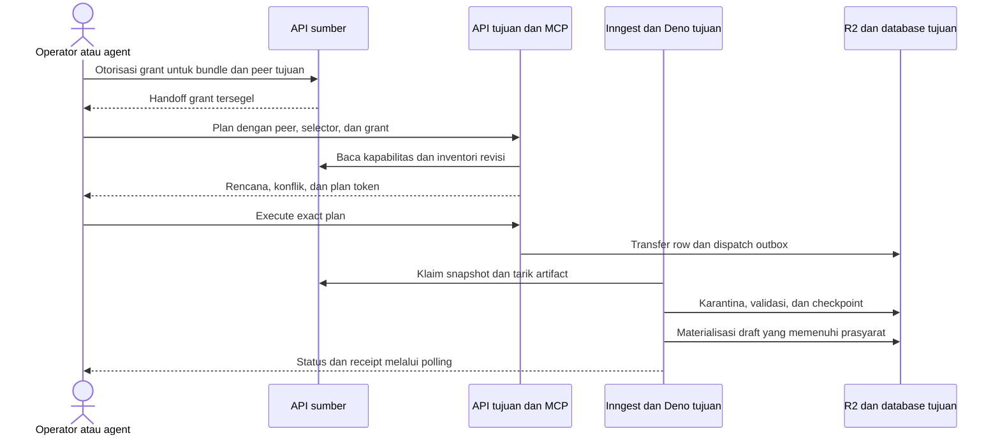

# Transfer Idea Bundle dan Product Bundle antar-environment

Status: `OPEN / IN PROGRESS`

Tanggal: 2026-10-23, Asia/Jakarta. Tahap: implementasi lokal sebagian. API peer/Admin, delapan tool MCP, schema additive, job/outbox, transfer exact-identity, serta pengujian lokal sudah ditulis. Tidak ada deployment atau transfer remote. Adapter identity/source figure dan penerimaan lengkap masih terbuka. Branch telah diganti menjadi `mcp/bundle-environment-transfer` sesuai permintaan.

Operator telah memilih always-on dengan peer registry, permission, dan direction policy, tanpa `FEATURE_*` baru. Kontrak implementasi aktual ada di [Authoring transfer V1](../docs/bundle/authoring-transfer-v1.md); perbedaan dari target roadmap dicatat di bagian 17. Bagian rancangan di bawah tetap menjelaskan target lengkap, bukan seluruh kapabilitas yang sudah tersedia.

Pemilik keputusan produk, akses lintas-environment, dan rollout: operator Zyx. Pemilik teknis yang diusulkan: maintainer authoring untuk kontrak dan lifecycle, maintainer platform untuk autentikasi peer dan compute. Nama endpoint, tool, tabel, field, konfigurasi, dan kode diagnostik di bawah adalah usulan.

## 1. Tujuan dan hasil yang diharapkan

Operator atau agent dapat menyalin Idea Bundle atau Product Bundle tertentu dari production ke staging maupun sebaliknya melalui API dan MCP. Server memindahkan artifact langsung, memeriksa dependensi, lalu memakai validator dan lifecycle authoring yang sudah ada. Pengguna tidak mengunduh atau mengunggah berkas. Agent tidak menyusun ulang konten, meneruskan ZIP/base64 melalui konteks percakapan, atau menerima kredensial database dan R2.

Contoh permintaan: "Salin Product Bundle A revisi X dari staging ke production, sertakan dependensi yang belum ada, simpan sebagai draft."

Hasil yang benar dapat berupa draft siap direview, tidak ada perubahan karena konten sudah identik, atau transfer yang menunggu prasyarat dengan alasan dan tindakan lanjut yang jelas. Selesainya penyalinan byte dibedakan dari terpenuhinya prasyarat staging dan publikasi.

Ukuran keberhasilan:

- Dua arah memakai protokol yang sama dan mengidentifikasi sumber serta tujuan secara eksplisit.
- Semua artifact dan dependensi terikat pada revisi, ukuran, dan hash yang diverifikasi di tujuan.
- Retry tidak menggandakan konten atau mengganti konten yang berubah sejak perencanaan.
- Proses dapat dilanjutkan setelah worker, jaringan, browser, atau agent terputus.
- Konten yang sudah published di tujuan tetap terlindungi dari overwrite.
- Review, PDF evidence, receipt verifikasi, dan publikasi tujuan tetap mengikuti gate yang berlaku.
- Setiap hasil memiliki receipt rekonsiliasi, termasuk item yang digunakan kembali, ditambahkan, tertunda, dan gagal.

## 2. Ruang lingkup dan batas

Rilis pertama mencakup transfer draft sebagai tujuan akhir, dependency closure, deteksi konflik, pemetaan identitas yang aman, job persisten, recovery, audit, dan MCP. Transfer sumber draft maupun published diperbolehkan selama revisinya dapat dibaca dan divalidasi. Sumber withdrawn, sedang dihapus, tidak valid, atau tidak dapat dipastikan konsisten diblokir.

Target lengkap mencakup Idea V3 serta learning Product V3 dan V4, termasuk Artikel, Diktat, flashcard set, dan flashcard. Kemampuan per jenis diumumkan secara eksplisit; fase yang belum mendukung source figure atau mapping tertentu wajib menolak kasus tersebut sebelum menulis konten. Dukungan seluruh target ini diperlukan sebelum fitur disebut lengkap.

V2 tetap mengikuti reader yang ada, tetapi transfer V2 dan Product berisi assessment bukan target rilis pertama. Tidak ada konversi V2/V3 menjadi V4 secara otomatis.

Di luar ruang lingkup: sinkronisasi seluruh database, deployment, data murid, enrollment, attempt, mastery, session, OAuth token pengguna, rahasia provider, penggabungan konten dengan AI, penghapusan sumber setelah transfer, publikasi otomatis, serta penyalinan vector index. Sumber tetap utuh. Vector outbox tujuan hanya muncul melalui publikasi lokal yang sah.

## 3. Dasar kode dan kontrak yang sudah ada

Pemeriksaan dilakukan pada branch baru dari remote `staging`, base commit `5bc14e33`. Temuan berikut adalah struktur lokal, bukan klaim deployment atau keberhasilan integrasi remote.

| Area | Sumber lokal | Implikasi |
| --- | --- | --- |
| Artifact impor | `db/schema.ts`, `imporBundle` | Identitas bundle, checksum, course, status, dan `sourceUriOrKey` sudah disimpan. |
| Idea lifecycle | `lib/bundle/staging.ts`, `lib/bundle/publication.ts` | Ada download/parse ZIP, pemeriksaan identitas, idempotensi impor identik, konflik, review, dan publikasi transaksional. |
| Product lifecycle | `lib/bundle/product-staging.ts`, `lib/bundle/product-publication.ts` | Impor identik adalah no-op, tetapi bundle ID sama dengan checksum berbeda dapat mengganti draft. Transfer harus menambahkan perlindungan eksplisit. |
| API admin | `app/api/admin/bundles/idea/route.ts`, `app/api/admin/bundles/product/route.ts` | Alur preview dan staging yang ada menerima upload. Layanan transfer perlu memanggil domain service bersama, bukan melakukan upload browser terselubung. |
| MCP staging | `lib/authoring/mcp-server.ts` | Pemeriksaan scope course/bab dan published Idea dilakukan sebelum Product submission. Transfer tidak boleh melewati pemeriksaan ini dengan memanggil service tingkat bawah. |
| Auth MCP | `lib/authoring/mcp-auth.ts`, `mcp-oauth.ts`, `mcp-workflows.ts` | Otorisasi terikat sesi admin aktif, scope, serta audience/environment. Token staging tidak boleh dipakai sebagai token production. |
| Kontrak versi | `lib/authoring/mcp-contract-revision.ts`, `docs/bundle/` | Tersedia versi dan fingerprint kontrak. Negosiasi transfer harus menambah kapabilitas yang spesifik. |
| Source figure | `lib/authoring/source-figures.ts` | Asset ID dan request mengikat identitas, scope, storage, serta versi sumber. Menyalin PNG dan manifest mentah tidak cukup. |
| Product V4 | `lib/bundle/product-v4-verification*.ts`, `docs/bundle/product-bundle-v4.md` | Receipt tepercaya mengikat import/run, dependensi, renderer, dan kebijakan. Receipt sumber tidak otomatis sah di tujuan. |
| Compute | `jobs/compute.ts`, `workers/deno-background/main.ts`, `jobs/web/` | Gunakan Inngest dan Deno compute untuk pekerjaan panjang. Web menangani autentikasi serta penerimaan job. |
| Storage | `lib/storage/keys.ts`, `lib/storage/` | Gunakan provider dan key builder yang ada, dengan ruang karantina transfer yang baru. |

Panduan terkait: `docs/ARCHITECTURE.md`, `docs/DEPLOYMENT.md`, `docs/features.md`, kontrak Idea V3 serta Product V3/V4, dan aturan repository di `AGENTS.md`.

## 4. Keputusan arsitektur

1. Tujuan memiliki transfer dan menjalankan job. Tujuan menarik artifact dari peer sumber melalui HTTPS, bukan membaca database atau bucket sumber secara langsung.
2. API dan MCP memakai satu application service. MCP hanya adapter parameter, otorisasi, dan hasil terstruktur.
3. Setiap environment memiliki registry peer yang dikonfigurasi operator. Agent memilih ID peer, bukan URL bebas.
4. Snapshot dan rencana immutable mengikat exact source revision, dependency closure, mapping, destination preconditions, dan policy. Eksekusi yang berbeda memerlukan rencana baru.
5. ZIP yang sudah tervalidasi digunakan kembali sebagai transport internal jika representasinya kompatibel. Protokol bukan fasilitas ekspor/impor manual.
6. Tujuan memvalidasi byte dan konten secara independen. Pernyataan `valid` dari peer tidak menggantikan validator tujuan.
7. Tidak ada transaksi global antara dua database dan R2. Gunakan state machine, transaksi lokal pendek, outbox, lease worker, dan rekonsiliasi.
8. V1 memakai mode `draft_only`, konflik `block`, serta dependency policy `include_missing`. Tidak ada pilihan force overwrite tersembunyi.
9. Konten dan attribution sumber dipertahankan dengan lineage. Aktor pelaksana transfer dicatat terpisah sebagai operator tujuan.
10. Kompatibilitas berarti memenuhi kontrak yang didukung kedua peer. Tidak berarti memperbaiki atau menurunkan versi konten secara diam-diam.



## 5. Identitas environment dan otorisasi dua sisi

### 5.1 Registry peer

Setiap peer memiliki `peerId`, environment ID immutable, origin aplikasi, origin API transfer, audience, public key dengan `keyId`, serta protokol dan direction policy. Nama `staging` dan `production` hanya label; identitas ditentukan konfigurasi operator dan diverifikasi melalui handshake bertanda tangan.

Source dan destination tidak boleh menunjuk environment, database, atau bucket yang sama akibat konfigurasi keliru. Periksa resource fingerprint server-side dengan nilai teredaksi; jangan mengirim connection URL atau kredensial ke agent. Key registry dan resource binding dikelola melalui deployment configuration, bukan input request.

Tidak ada arbitrary URL, redirect lintas-origin, alamat internal, credential pada URL, atau callback URL dari manifest. HTTP client memakai origin allowlist, timeout, batas byte, dan kebijakan tanpa redirect. Local test memakai peer fixture yang hanya aktif dalam konfigurasi pengujian.

### 5.2 Grant terbatas dari sumber

Agent/operator harus berwenang di sumber dan tujuan secara terpisah. Langkah awal memakai sesi/OAuth admin sumber untuk membuat grant dengan selector bundle, revisi, course/bab yang diperbolehkan, batas dependency closure, peer tujuan, expiry, dan batas jumlah/byte. Source grant tidak memberi hak menulis konten sumber atau mempublikasikan tujuan.

Gunakan protokol dan library standar untuk signature serta sealed envelope, misalnya Ed25519 untuk signature dan JWE untuk handoff yang hanya dapat dibuka peer tujuan. Pilihan library harus dibuktikan kompatibel dengan Next dan Deno sebelum dikunci. Jangan membuat algoritme kriptografi sendiri atau memakai `BETTER_AUTH_SECRET` bersama antar-environment.

Opaque handoff boleh diteruskan agent, tetapi isinya tidak boleh memuat raw session/OAuth token, akses R2, atau rahasia server. Perlakukan handoff sebagai capability sensitif: jangan cetak di log, URL, analytics, error, screenshot, atau receipt. Handoff mengikat `issuer`, `audience`, `grantId`, `jti`, expiry, snapshot scope, dan target key ID. Target menyimpannya terenkripsi jika perlu dilanjutkan oleh job.

Grant hanya dapat diklaim oleh satu transfer tujuan; retry transfer yang sama diperbolehkan. Grant baru diperlukan untuk scope atau revisi berbeda. Sumber mencatat claim dan revocation. Rotate key dengan periode overlap terbatas; key yang dicabut tidak diterima untuk claim baru.

### 5.3 Hak agent dan durasi job

Usulan scope baru: `authoring:transfer:source` untuk grant sumber, `authoring:transfer:read` untuk preview/status, dan `authoring:transfer:execute` untuk create/resume/cancel tujuan. Jangan menambahkannya ke default scope atau token lama secara otomatis. Update discovery, consent, dokumentasi, dan pengujian OAuth; pengguna melakukan reauthorization jika memerlukan scope baru.

Token lama dengan `authoring:stage` tidak otomatis mendapat kewenangan lintas-environment. API sesi admin memakai guard canonical yang sama, ditambah direction policy dan otorisasi transfer.

Job bukan perpanjangan diam-diam sesi browser. Eksekusi membuat delegasi pekerjaan terbatas dengan expiry maksimal yang eksplisit. Baseline usulan: preview 15 menit, handoff untuk claim 15 menit, delegasi transfer dan snapshot lease 24 jam. Revalidasi aktor admin aktif dan grant pada batas checkpoint; revoke/penurunan hak menghentikan checkpoint selanjutnya. Logout atau kedaluwarsa sesi pembuat grant menghentikan delegasi pada pemeriksaan berikutnya. Resume setelah itu membutuhkan otorisasi baru, tetapi tetap dapat memakai artifact terverifikasi yang belum kedaluwarsa.

Sumber harus menyediakan validasi delegasi yang terautentikasi dan dapat dicabut. Tidak ada pemeriksaan sesi sumber melalui database tujuan. Nilai durasi di atas adalah keputusan CP0, bukan konfigurasi yang telah diterapkan.

## 6. Kontrak protokol dan API

### 6.1 Kapabilitas dan kompatibilitas

Handshake mengiklankan versi protokol, environment ID, build revision, versi kontrak bundle yang diterima, fingerprint policy, source-figure adapter, batas ukuran, dukungan Range/resume, dan key aktif. Metadata konfigurasi rahasia tidak diekspos.

Build revision berbeda tidak otomatis incompatible. Protocol/schema/asset capability yang diperlukan harus cocok. Policy tujuan selalu berlaku. Converter baru hanya boleh dipakai setelah ada kontrak eksplisit, fixture kesetaraan, catatan perubahan ID/hash, dan persetujuan scope. V1 mendukung exact-version copy dan adapter mapping terbatas yang dibuktikan; versi yang tidak didukung diblokir.

### 6.2 Endpoint yang diusulkan

| Endpoint | Lingkungan | Fungsi dan mutasi |
| --- | --- | --- |
| `GET /api/authoring/transfers/capabilities` | Kedua peer | Baca metadata protokol minimum. Detail peer terproteksi. |
| `POST /api/admin/transfers/source-grants` | Sumber | Buat grant terbatas; menulis metadata otorisasi dan audit, bukan konten. |
| `DELETE /api/admin/transfers/source-grants/:id` | Sumber | Revoke grant dan hentikan pembacaan selanjutnya. |
| `POST /api/internal/transfers/inspect` | Sumber | Baca inventori exact revision di bawah grant. Tidak menyalin konten. |
| `POST /api/internal/transfers/snapshots` | Sumber | Klaim grant, pin artifact, dan simpan snapshot lease untuk transfer tujuan. |
| `GET /api/internal/transfers/snapshots/:id/artifacts/:artifactId` | Sumber | Stream byte immutable dengan checksum, ETag, dan Range yang tervalidasi. |
| `POST /api/internal/transfers/snapshots/:id/release` | Sumber | Lepas lease idempotently; tidak menghapus konten authoring sumber. |
| `POST /api/admin/transfers/plan` | Tujuan | Preview read-only terhadap konten, menghasilkan signed plan token. |
| `POST /api/admin/transfers` | Tujuan | Terima plan dan idempotency key, buat job, respons `202`. |
| `GET /api/admin/transfers/:id` | Tujuan | Status, checkpoint, blockers, dan receipt teredaksi. |
| `POST /api/admin/transfers/:id/resume` | Tujuan | Lanjutkan checkpoint yang masih sah. |
| `POST /api/admin/transfers/:id/cancel` | Tujuan | Minta pembatalan kooperatif. |

Semua endpoint internal memerlukan peer authentication dan grant/delegasi yang scope-nya tepat. Grant sumber wajib untuk inspect; kapabilitas public minimum tidak membuka inventori course. Penamaan path final dikunci di CP0.

Preview tidak menjanjikan source snapshot retention karena belum ada snapshot lease. Ia membaca keadaan konsisten, menerbitkan token bertanda tangan, dan tidak menulis domain content atau transfer job. Logging operasional biasa tetap mungkin. Pembuatan grant adalah metadata mutation terpisah dan harus dijelaskan kepada agent.

Saat execute, sumber harus dapat mengambil byte persis yang direncanakan. Jika draft diganti atau dihapus sebelum snapshot diklaim, kembalikan `SOURCE_REVISION_CHANGED`; jangan mengambil latest. Snapshot lease wajib melindungi byte dari cleanup/replacement sampai expiry, termasuk source draft restage dan discard. Integrasikan reference pin dengan cleanup source, bukan hanya menyimpan path yang bisa dihapus. Jika tidak dapat pin seluruh closure, release pin parsial dan tolak sebelum materialisasi tujuan.

### 6.3 Bentuk rencana dan hasil

Input plan minimum: `sourcePeerId`, `sourceGrant`, selector `{ kind, importId, expectedChecksum }`, target course/bab mapping, dependency policy, dan `mode=draft_only`. Target identity berasal dari server penerima, bukan label bebas dari agent.

Output plan: `protocolVersion`, environment sumber/tujuan, exact revision, `closureHash`, `mappingHash`, `planHash`, expiry, ringkasan byte/item, aksi per item, konflik, prasyarat, dan `planToken`. Token mengikat aktor tujuan, grant ID, capability revisions, destination preconditions, policy, serta batas transfer. Token tidak memuat raw storage keys atau credential.

Aksi item: `reuse`, `copy`, `derive_asset`, `wait_for_publication`, atau `block`. `reuse` memerlukan kecocokan isi, scope, status, versi, dan dependensi, bukan kesamaan ID saja. Exact artifact bytes, semantic hash, dan generation hash adalah field berbeda dan tidak dapat dipertukarkan.

Execute memerlukan `planToken`, `planHash`, dan `Idempotency-Key`. Identitas key di-scope oleh aktor, environment tujuan, dan tipe operasi. Key sama dengan request hash berbeda menghasilkan `409`. Source/destination precondition yang berubah menghasilkan `409 PLAN_STALE`, meskipun key baru digunakan.

Status membedakan `transportComplete`, `draftMaterialized`, dan `publicationPrerequisitesSatisfied`. Receipt final hanya menyatakan yang benar-benar diverifikasi, dengan ID konten tujuan yang boleh dilihat aktor, hash sumber/hasil, transformasi, reuse/copy count, blocker, serta waktu rekonsiliasi.

### 6.4 Tool MCP

| Tool | Fungsi |
| --- | --- |
| `transfer.capabilities` | Menemukan peer yang boleh dipakai dan dukungan versi. |
| `transfer.create_source_grant` | Meminta delegasi terbatas melalui MCP sumber. |
| `transfer.revoke_source_grant` | Mencabut delegasi yang dibuat atau dikelola aktor berwenang. |
| `transfer.plan` | Preview melalui MCP tujuan. |
| `transfer.execute` | Menerima exact plan dan mengembalikan transfer ID. |
| `transfer.status` | Polling ringkas dengan cursor/retryAfter dan link tujuan. |
| `transfer.resume` | Melanjutkan transfer yang memenuhi prasyarat. |
| `transfer.cancel` | Membatalkan pekerjaan yang belum selesai. |

Source grant dibuat pada koneksi MCP sumber; plan/execute/status melalui koneksi tujuan. Agent memerlukan dua koneksi yang diotorisasi secara independen. MCP tidak memperoleh koneksi baru secara ajaib. API Admin dapat menyediakan handoff yang sama tanpa MCP.

Update capability discovery dan bootstrap/playbook yang ada. Tambahkan modul panduan transfer yang menegaskan tidak ada regenerasi isi, pemilihan latest otomatis, atau publikasi melalui tool transfer. Distribusi plugin/skill mengikuti lock dan workflow yang sudah ada; tidak membuat salinan panduan normatif terpisah.

## 7. Dependency closure, mapping, dan integritas konten

### 7.1 Closure deterministik

Mulai dari exact import revision. Telusuri source materials, source chunks, provenance, Idea relations dan learning sections, Idea links Product, external Product dependencies, Article/Diktat lineage, source pack yang benar-benar dirujuk, original PDF, dan source figures. Learning content saja yang masuk closure.

Gunakan inventori terurut, hash per item, dan graph hash. Deteksi cycle yang tidak didukung, dangling reference, konten di luar grant, dependensi tersembunyi, serta duplikasi ID dengan isi berbeda. Dependency lintas-bab atau lintas-course harus memperluas scope secara eksplisit; jangan menyertakan seluruh course hanya untuk memudahkan resolver.

Jika canonical dependency di sumber sudah berbeda dari artifact historis yang dirujuk root, resolver harus menemukan exact revision yang sah. Jika tidak tersedia, blokir dengan diagnostic. Jangan mengganti referensi ke versi terbaru. Batas awal usulan: 500 entity dependency, 100 artifact, total 512 MiB per transfer, concurrency download 3, dengan batas per artifact mengikuti validator aktif. CP0 mengunci angka berdasarkan fixture nyata; exceeding limit gagal saat plan.

### 7.2 Mapping course, bab, penulis, dan ID

| Kasus | Kebijakan V1 |
| --- | --- |
| ID dan scope cocok, hash isi cocok | Gunakan ulang setelah status diperiksa. |
| Course/bab tujuan tidak tersedia | Blokir dan minta entity tujuan dibuat melalui alur yang ada. |
| Nama sama, ID berbeda | Tampilkan kandidat; wajib mapping eksplisit, tidak cocok otomatis dari nama. |
| Creator/curator belum ada | Map ke pengguna tujuan yang sah dengan provenance penulis sumber tetap tersimpan, atau blokir. Jangan menyalin akun. |
| Bundle/entity ID sama, isi berbeda | Blokir, termasuk draft. Tidak memanggil kemampuan replacement Product secara implisit. |
| ID berbeda, isi sama | Jangan deduplikasi otomatis jika merusak identity atau lineage; pakai adapter mapping yang didukung atau blokir. |
| Bundle sudah withdrawn di tujuan | Blokir; no-op checksum sama tidak boleh menyamarkan state ini. |

Pertahankan stable IDs ketika memungkinkan. Mapping yang mengubah field terikat hash harus lewat adapter deterministik yang memahami schema. Adapter memperbarui semua referensi terkait, generation/semantic hash sesuai fungsi canonical yang berlaku, manifest checksum, dan dependency hash secara topologis, kemudian menjalankan validator penuh.

Simpan source revision dan destination revision terpisah beserta mapping/transform receipt. Jangan mempertahankan checksum lama untuk konten yang telah berubah. Jangan mengganti semua creator dengan aktor eksekusi atau menyalin `requestedBy` sumber sebagai aktor lokal. Jika canonical identity sudah terpakai dengan isi berbeda, V1 menolak; strategi fork identitas adalah perluasan terpisah.

### 7.3 Urutan dan prasyarat published Idea

1. Tarik seluruh closure ke karantina, verifikasi, dan siapkan mapping tanpa menulis canonical published rows.
2. Materialisasikan Idea Bundle draft melalui shared validator/staging service.
3. Jika Idea yang diperlukan sudah published dan cocok di tujuan, lanjutkan Product staging.
4. Jika Idea belum published, simpan Product artifact pada intake transfer dan tandai `waiting_prerequisites`. Item tersebut belum dianggap Product draft normal dan tidak muncul di reader/student.
5. Operator mereview serta mempublikasikan Idea melalui alur tujuan yang ada, dengan otorisasi tersendiri.
6. Resume memeriksa exact Idea version/hash, chapter scope, dan policy sebelum Product menjadi draft normal.
7. Review, PDF generation, trusted verification, dan publikasi Product berlangsung melalui alur tujuan yang ada.

Transfer tidak mempublikasikan dependency untuk membuat dirinya selesai. Ia juga tidak membuat Product draft dengan melewati gate published Idea yang berlaku pada MCP. Pemeriksaan yang tersebar di MCP perlu diekstrak menjadi shared application validation yang dapat dipakai adapter lama dan transfer tanpa memperlemah perilaku consumer yang sudah ada.

## 8. Aset, original PDF, dan evidence V4

Original PDF disalin hanya bila closure membutuhkan bukti/figure tersebut dan rights mengizinkan pemindahan. Course material row tujuan memakai storage key lokal melalui `lib/storage/keys.ts`; object storage source URL, signed URL, session token, serta file token tidak disimpan sebagai referensi durable tujuan.

Untuk source figure, verifikasi original checksum, Source Pack binding, halaman/crop, rights, preview/print variants, dan manifest. Request saat ini mengikat aktor/session, storage key, material version, dan scope sumber. Karena itu V1 tidak boleh menyalin request/manifest mentah dan menganggap asset valid.

CP1 membuat spike adapter figure: rekonstruksi request dalam scope tujuan menggunakan bytes original yang sama dan metadata crop tervalidasi, jalankan extractor yang ada, dapatkan asset ID tujuan, lalu rewrite referensi Product dan hash terkait melalui adapter deterministik. Catat figure lineage dan perbedaan renderer/hasil. Jika adapter tidak mempertahankan makna, rights tidak jelas, atau original tidak ada, plan diblokir. Dukungan ini merupakan syarat fitur lengkap untuk V4 dengan source figure.

Source Pack provenance bukan sekadar ZIP opsional. Transfer harus menyelesaikan token atau run-local binding menjadi rekam asal yang dapat dibuktikan dan diregistrasi ulang di tujuan melalui service yang ada. Jangan mengirim source file token sebagai token tujuan. Binding yang belum memiliki adapter didiagnosis sebagai unsupported.

Tidak menyalin approvals atau PDF/verification receipts sebagai evidence aktif. Metadata asal boleh dicatat sebagai histori teredaksi, tetapi tidak diklaim sebagai keputusan reviewer tujuan. PDF tujuan dibangun ulang, asset dibaca dari storage tujuan, dan verifikasi V4 dijalankan ulang dengan policy dan renderer tujuan. Agent tidak mengganti keputusan pedagogis dengan hasil transfer checksum.

## 9. Persistensi yang diusulkan

Semua tabel baru additive di Turso/SQLite melalui Drizzle. Nama final diselaraskan dengan naming canonical repository di CP0.

| Tabel konseptual | Data penting dan constraint |
| --- | --- |
| `authoring_transfer` | ID, peer/environment identities, actor, plan/closure/mapping hashes, mode, state, stateVersion, idempotency key/request hash, authorization expiry, timestamps, retry data, receipt summary. Unique idempotency scope. |
| `authoring_transfer_item` | Transfer ID, item identity/type, source revision/hash, target identity/hash, action, state, byte count, quarantine key, materialized import ID, ownership flag, blocker/error. Unique per transfer item identity. |
| `authoring_transfer_mapping` | Mapping canonical source/target identity dan versi dengan provenance; immutable per plan. Tidak memuat akun/session sumber. |
| `authoring_transfer_grant` | Issuer side: grant ID, creator/session binding, target peer, allowed closure, expiry, revocation, claimed transfer ID. No raw user token. |
| `authoring_transfer_snapshot` | Source lease, immutable artifact refs/checksums, target transfer claim, expiresAt/releasedAt, reference pins. Renewal terbatas dan terotorisasi. |
| `authoring_transfer_outbox` | Dispatch/recovery event ID, transfer/stateVersion, send status, attempts. Unique event ID, penulisan atomik bersama transfer state. |

Reuse `auditMutasi` untuk event mutasi dengan redaksi; jangan menduplikasi blob, grant, atau respons penuh pada audit. Delegasi/envelope sensitif disimpan terenkripsi pada record yang tepat dengan key version dan expiry. Mutable status tidak disimpan hanya di JSON validation report bundle.

Kebutuhan index: transfer menurut actor/state/update time, item menurut transfer/state, source lease menurut artifact/expiry, grant menurut claim/revocation/expiry, outbox menurut pending/retryAt. Pembaruan state memakai compare-and-swap `stateVersion` dan worker lease/fencing token. Tambahkan foreign key dan uniqueness yang dibutuhkan, termasuk ownership provenance untuk cleanup.

Schema workflow implementasi: edit `db/schema.ts`, `bun run db:generate`, dan `bun run db:migrate` dengan database lokal yang terverifikasi. Jangan menjalankan migrasi remote sebagai efek samping pengembangan atau mengedit hasil generate secara manual.

## 10. State machine, concurrency, dan pemulihan

Preview menghasilkan rencana atau daftar blocker tanpa transfer row. Setelah execute diterima:

```text
queued -> snapshotting -> copying -> validating -> materializing
materializing -> completed
materializing -> waiting_prerequisites -> validating
setiap tahap aktif -> retry_wait -> tahap checkpoint terakhir
setiap tahap aktif -> blocked atau failed
setiap tahap aktif -> cancelling -> cancelled
```

`completed` berarti root draft sudah dimaterialisasikan, atau root yang identik dan berstatus layak sudah ditemukan. Receipt menandai `existing_published` bila root tujuan memang sudah published, tanpa mengubah statusnya. `waiting_prerequisites` bukan completed dan bukan kegagalan transport. `blocked` memerlukan tindakan manusia atau plan baru; `failed` berarti error terminal setelah kebijakan retry habis.

Outbox dispatcher dan sweep periodik memulihkan kasus transaksi transfer berhasil tetapi kirim event Inngest gagal. Gunakan event ID deterministik. Semua handler aman terhadap duplicate delivery. Worker lease yang kedaluwarsa dapat diambil worker baru; worker lama tidak boleh commit setelah kehilangan fencing token.

Download resume memakai ETag/checksum expected, Range, offset, dan verifikasi akhir seluruh bytes. Jika provider tidak mendukung resume, unduh ulang artifact tersebut dengan batas yang sama, bukan mengulang seluruh transfer. Tidak menyimpan offset sebagai bukti checksum penuh. Hash mismatch, signature invalid, dan schema violation tidak diretry sebagai gangguan jaringan.

Retry transient memakai exponential backoff, jitter, `Retry-After`, timeout, dan attempt limit. Usulan awal: 5 attempt per artifact, maksimal backoff 5 menit, lalu `failed` dengan checkpoint tetap tersimpan sampai retention berakhir. `401/403`, revoked grant, scope mismatch, rights unknown, dan conflict menjadi blocked tanpa retry loop.

Race tujuan diperiksa kembali tepat sebelum materialisasi dengan expected versions dan unique constraints dalam transaksi lokal. Dua transfer yang sama dapat berbagi hasil konten identik, tetapi masing-masing memiliki receipt. Dua konten berbeda dengan identity sama harus menghasilkan satu commit sah dan satu conflict, tanpa last-writer-wins. Shared staging service perlu mode eksplisit `create_or_reuse_exact` yang tidak mengubah perilaku consumer lama.

Cancellation kooperatif memblokir commit baru setelah fence cancellation diambil. Item yang sudah committed tetap dicatat pada receipt, termasuk commit yang sah sebelum cancellation. Tidak menghapus reused object, shared source, atau draft yang sudah diedit/dipublikasikan. Cleanup hanya menghapus quarantine atau object milik transfer yang belum direferensikan, dengan recheck ownership dan reference dalam boundary yang aman.

Resume memeriksa authorization, source snapshot lease, hash hasil lokal, destination preconditions, dan policy. Jika lease expired atau source berubah, minta plan/grant baru. Checkpoint lama hanya digunakan jika byte dan mapping masih cocok dengan rencana baru; tidak meneruskan persetujuan lama secara implisit.

## 11. Storage, retensi, dan observabilitas

Tambahkan key builder terpusat untuk `overhaul/transfers/{transferId}/...`, dengan leaf deterministik dari item ID dan checksum, serta validasi key yang sudah ada. Exact prefix final mengikuti kontrak storage repository. Canonical bundle yang dimaterialisasikan tetap memakai builder Idea/Product yang ada.

Karantina private, tidak tersedia melalui student routes, dan tidak dapat dipakai sebagai source URL bebas. Streaming transfer dilakukan pada compute dengan batas memory/byte yang jelas. Jangan memuat seluruh closure sekaligus di RAM atau response MCP.

Usulan retensi: source snapshot lease maksimal 24 jam; quarantine transfer aktif/tertunda 7 hari; blob sensitif grant dihapus setelah expiry dan grace recovery; metadata audit/receipt 90 hari atau kebijakan operator yang disepakati. Cleanup job memperhitungkan transfer aktif, reference pins, legal/rights holds, dan ownership. Transfer yang masih menunggu setelah lease berakhir memerlukan reauthorization/replan, walaupun local quarantine belum dibersihkan.

Metric: durasi per tahap, queued age, bytes verified, deduplication/reuse, retry count, waiting age, lease expiry, grant rejection, integrity failure, dan cleanup failure. Log hanya transfer ID, peer ID, item type, reason code, dan timing. Tidak ada token, raw source text, filename pribadi, secret, database URL, atau signed download URL.

Alert untuk stuck lease, dispatch backlog, checksum mismatch berulang, atau akses peer ditolak berulang. Semua status memiliki reason code stabil dan recovery action berbahasa Indonesia. Contoh: `PLAN_STALE`, `DEPENDENCY_NOT_PUBLISHED`, `IDENTITY_CONFLICT`, `ASSET_BINDING_UNSUPPORTED`, `GRANT_REVOKED`, `SOURCE_ARTIFACT_UNAVAILABLE`, `CHECKSUM_MISMATCH`, dan `TRANSFER_LIMIT_EXCEEDED`.

## 12. Tahap implementasi dan kriteria selesai

| Checkpoint | Pekerjaan | Kriteria selesai |
| --- | --- | --- |
| CP0, keputusan dan kontrak | Tetapkan direction policy, release gating, scope/consent, limits/retention, dukungan versi, schema plan/receipt, dan threat model. | Keputusan operator dicatat; kontrak protokol serta fixture kompatibilitas tersedia. Belum ada remote mutation. |
| CP1, dependency dan mapping spike | Inventori deterministik, exact revisions, hash graph, creator/course mapping, source pack binding, spike source figure dan transform hash. | Fixture Idea, Product V3, V4 text, serta V4 figure membuktikan dukungan atau blocker eksplisit. Tidak ada reference yang hilang. |
| CP2, schema dan otorisasi peer | Additive schema, peer registry, key handling, grant claim/revocation, source snapshot pins, retention. | Local migrations dan auth tests lulus. Cross-environment token replay, expiry, revoke, dan cleanup races ditolak. |
| CP3, plan dan execution core | API shared service, pure preview, signed plan, idempotency, quarantine, validator tujuan, transaction preconditions. | Dua fixture peer lokal dapat copy Idea dengan hash/reuse/conflict yang benar. |
| CP4, job dan recovery | Deno worker, Inngest registration, transactional outbox, fencing, retries, resume/cancel, cleanup. | Crash injection setiap boundary pulih tanpa duplikasi, overwrite, atau deletion konten bersama. |
| CP5, Product dan aset lengkap | Dependency staging order, waiting/resume, Product materialization, source PDF/figure adapters, revision lineage, evidence reset. | Product V3/V4 termasuk fixture figure berhasil menjadi draft tujuan; missing published Idea berhenti dan resume setelah publikasi lokal sah. |
| CP6, MCP dan panduan agent | Tools, scope enforcement, bootstrap/discovery, status polling, playbook dan distribusi plugin. | Agent dengan dua koneksi dapat menyelesaikan skenario tanpa membawa blob/credential atau melewati gate. |
| CP7, penerimaan staging | Rollout terpisah yang diotorisasi, dua peer non-production, private artifacts, rights fixtures, actual Deno/Inngest/R2. | Receipt runtime dan rekonsiliasi sesuai state database/storage. Tidak memakai data pribadi atau production credentials. |
| CP8, production canary | Exact target review, source/target read-only preflight, otorisasi transfer spesifik, canary terkontrol kedua arah. | Bukti boundary production terpisah; no overwrite, source unchanged, draft/review gates tetap berlaku. |

CP2 sampai CP4 dapat dipecah menjadi PR kecil, tetapi layanan tidak diumumkan lengkap sebelum CP5 dan CP6 selesai. Jangan menjadikan dukungan text-only sebagai klaim bahwa semua Product V4 dapat dipindahkan.

### 12.1 Peta perubahan file yang diusulkan

- `lib/authoring/transfer/`: kontrak, peer client, authorization, resolver, mapping, plan, execution, receipts, dan cleanup. Keep server-only boundaries eksplisit.
- `lib/bundle/`: shared stage validation dan mode create/reuse yang eksplisit; reuse existing validators, publication, attribution, dan hash helpers.
- `db/schema.ts` dan generated `drizzle/`: transfer ledger, item, mapping, grant, snapshot, outbox.
- `lib/storage/keys.ts`: transfer quarantine builders dan validasi.
- `lib/env.ts` dan worker env validation: registry/key configuration server-only dengan schema dan secret redaction.
- `app/api/admin/transfers/` dan `app/api/internal/transfers/`: thin authenticated handlers. Baca panduan route handler Next 16.3 yang terpasang sebelum implementasi.
- `jobs/authoring-transfer.ts`, `jobs/compute.ts`, worker env/entrypoints: execution dan recovery jobs, compute-only imports, registration yang sesuai.
- `lib/authoring/mcp-server.ts`, `mcp-workflows.ts`, `mcp-oauth.ts`, discovery/consent consumers: tools dan scope baru.
- `lib/authoring/playbooks/` dan jalur distribusi skills yang sudah ada: prosedur transfer dan capability gating.
- `tests/`: unit resolver, kontrak peer, service integration, recovery, security, serta MCP acceptance fixtures; pilih folder mengikuti pola test repository saat implementasi.

V1 tidak memerlukan halaman Admin baru. API sesi admin dan MCP cukup untuk penggunaan awal. Jika UI diminta kemudian, tambahkan aksi pada workspace review yang ada, dengan shared primitives dan visual checks wajib; jangan membangun dashboard transfer terpisah tanpa kebutuhan.

## 13. Matriks pengujian dan acceptance

| Area | Skenario wajib | Bukti yang diharapkan |
| --- | --- | --- |
| Dua arah | Peer A ke B dan B ke A, dengan resource terpisah | Exact identities dan receipt benar, sumber utuh. |
| Versi | Idea V3, learning Product V3/V4, unsupported V2/assessment, protocol mismatch | Dukungan cocok berjalan; unsupported diblokir sebelum domain writes. |
| Dependency | Sudah lengkap, missing Idea, cross-chapter, cycle, dangling, stale hash, historical revision unavailable | Closure deterministic dan scope tepat; wait/block dengan recovery action. |
| Mapping | Course/bab cocok, explicit mapping berbeda ID, creator missing, canonical identity conflict | Referensi dan hash valid atau gagal tertutup. |
| Aset | Original/figure lengkap, missing preview/print, source pack mismatch, rights unknown, changed renderer | Byte/hash/binding diperiksa; tidak ada cross-environment URL tersisa. |
| Evidence | Sumber published/approved, PDF ready, V4 trusted receipt valid di sumber | Tujuan tetap draft dan evidence baru diperlukan. |
| Idempotensi | Duplicate request/event, same key different payload, concurrent same/different revision | No duplicate dan no unintended overwrite. |
| Race | Source restage/discard sebelum dan setelah pin, tujuan diedit/published setelah plan | Stale plan atau pin protection; draft tujuan tidak tertimpa. |
| Recovery | Crash setelah copy, DB commit, sebelum dispatch, setelah commit sebelum ack; worker lease hilang | Replay aman dengan receipt dan outbox konsisten. |
| Jaringan | Timeout, 429, 5xx, truncated stream, Range unsupported, incorrect ETag/hash | Backoff terbatas, restart per artifact, integrity fail terminal. |
| Auth | Wrong audience/peer/key, expired/revoked grant, logout, role downgrade, source grant reused for another job | Tidak ada akses/mutasi di luar scope; resume perlu otorisasi sah. |
| SSRF dan disclosure | Arbitrary origin/redirect/private IP, unsafe key/path, oversized closure, log/token leakage | Request ditolak dan log tetap teredaksi. |
| Cancel/cleanup | Cancel saat materialisasi, reused asset, draft edited/published, expired snapshot | Fence benar; konten shared atau sudah diubah tidak dihapus. |
| MCP | Old token tanpa scope, dua audience, reconnect, stale catalog, polling | Error actionable; tidak ada asumsi auth lintas-host. |
| Boundary runtime | Actual Deno worker, Inngest environment, R2 byte readback, Turso transaction | Evidence terpisah dari local fixture results. |

Gunakan deterministic local fixtures dan dua peer test server dengan database SQLite serta storage fixture yang terpisah. Jangan menguji algoritme dengan production credentials. Local integration perlu benar-benar memanggil HTTP peer, tidak hanya mock function return. Fault injection mencakup batas DB/storage/event dan auth revocation.

Validasi implementasi lintas-modul: focused unit/integration tests, `bun run lint`, `bun run typecheck`, dan `bun run build` karena ada schema, core library, auth, dan runtime boundary. Record command, exit status, serta failure output; pisahkan kegagalan bawaan dari regresi. Untuk compute jalankan audit/check Deno dan dependency boundary scripts yang didokumentasikan, setelah memastikan command aktual di `package.json`.

Perubahan consent atau UI lain memerlukan primary-agent Playwright dan inspeksi screenshot setiap state yang berubah pada 380x844 serta 1536x864. Ikuti `AGENTS.md`; default screenshot route saja tidak cukup untuk interaksi. Dokumentasi ini tidak mengubah UI sehingga tidak memerlukan visual sign-off.

## 14. Rollout, gating, dan rollback

Pembuatan rencana ini tidak mengotorisasi deployment, perubahan secret, bucket, key registry, migrasi remote, transfer production, atau publikasi konten. Setiap langkah remote memeriksa exact environment dan target melalui read-only preflight sesuai aturan repository.

Keputusan always-on versus feature flag harus diminta sebelum implementasi karena fitur baru ini dapat digate. Rekomendasi: protokol yang tersedia hanya setelah peer dan permission dikonfigurasi, dengan kebijakan direction eksplisit. Apakah perlu flag tambahan tetap keputusan operator. Tidak ada `FEATURE_*` yang ditambahkan oleh rencana ini.

Jika operator memilih flag sementara, CP0 wajib menetapkan key, rationale, default off, environment/direction scope, owner, rollback path, removal condition, dan expiry atau removal issue. Jika always-on dipilih, registry dan permission tetap membatasi akses; jangan menggunakan ketiadaan secret sebagai satu-satunya kill switch operasional.

Urutan rollout: schema additive lokal, compatible API di kedua peer, worker dan env validation, registrasi Inngest pada environment benar, key/peer registry terbatas, smoke read-only handshake, synthetic transfer non-production, MCP/consent release, lalu canary yang diotorisasi. Source snapshot/grant service harus tersedia sebelum tujuan dapat execute.

Jangan memberi staging akses baca seluruh production. Production ke staging memerlukan source grant per bundle/closure yang diizinkan. Catat rights dan data minimization dari konten yang dipilih.

Rollback operasional: tolak execute/claim baru melalui direction policy, biarkan status tetap terbaca, hentikan atau cancel job pada checkpoint aman, revoke grant yang terdampak, dan rekonsiliasi artifact. Pertahankan schema additive dan audit. Tidak ada down migration atau penghapusan konten hasil transfer otomatis. Draft milik transfer yang belum berubah dapat dihapus melalui alur draft deletion yang sudah ada setelah pemeriksaan dependency/ownership; publikasi yang sudah terjadi ditangani melalui withdrawal lokal dengan otorisasi tersendiri.

Sebelum produksi, runbook harus memuat pemulihan grant expired, lost worker lease, unmaterialized intake, orphan quarantine, source pin stuck, key rotation, incompatible deploy, dan conflict yang memerlukan replan. Rehearsal rollback wajib pada peer non-production.

## 15. Pembaruan dokumentasi saat implementasi

Setiap PR memperbarui hanya dokumen yang menjadi relevan atau tidak akurat: `docs/DB_SCHEMA.md`, `docs/ARCHITECTURE.md`, `docs/features.md`, `docs/DEVELOPMENT.md`, `docs/DEPLOYMENT.md`, kontrak transfer baru di `docs/bundle/`, dan runbook transfer di `docs/operations/`. Registrasikan setiap perubahan Markdown di `docs/README.md` pada PR yang sama.

Kontrak transfer tidak mengubah kontrak authoring menjadi bebas dependency atau bebas review. Bedakan status protocol support lokal, migrasi, deployment peer, runtime smoke, MCP host acceptance, dan production canary. Plan tetap `OPEN / IN PROGRESS` sampai acceptance scope yang disepakati selesai dan dibuktikan.

## 16. Keputusan terbuka dan checklist handoff

Sebelum menulis implementasi:

- [x] Operator memilih always-on dengan peer policy, tanpa `FEATURE_*` baru.
- [ ] Tetapkan penanggung jawab teknis, peer direction policy, key custody/rotation, dan scope consent.
- [ ] Setujui batas byte/entity, TTL grant/delegasi/lease, retensi, serta konsekuensi logout/revocation.
- [ ] Setujui draft-only, konflik block, missing course/user block-or-map, dan tidak ada auto-publish dependency.
- [ ] Kunci schema/endpoint/tool names dan kemampuan exact-version serta mapping yang benar-benar didukung.
- [ ] Buktikan adapter Source Pack dan source figure sebelum mengklaim dukungan V4 lengkap.

Status pekerjaan pada branch rencana ini:

- [x] Ambil remote `staging` dan buat branch `mcp/bundle-environment-transfer` dari commit `5bc14e33`.
- [x] Periksa struktur lifecycle bundle, auth MCP, compute, source figures, dan dokumentasi terkait secara lokal.
- [x] Susun rencana dan daftarkan statusnya di indeks dokumentasi.
- [ ] Implementasi CP0 sampai CP6.
- [ ] Penerimaan staging dan production sesuai otorisasi terpisah.

## 17. Status implementasi lokal dan pekerjaan tersisa

Sudah ditulis: source grant EdDSA/JWE, pemeriksaan actor/session canonical, peer/direction registry, resource fingerprint, signed inventory/plan, dependency closure bertopologi, byte verification tujuan, source snapshot immutable, staging fence transaksional, idempotency dan concurrent retry, ledger/outbox, worker/recovery/cleanup Inngest, resume/cancel, audit, delapan tool MCP, opt-in OAuth consent/connection scope, dan generator identity lokal. Migrations `0098` dan `0099` dihasilkan melalui Drizzle dan diterapkan hanya pada database SQLite sementara.

Baseline CP0: always-on dipilih operator; mode draft-only, block conflict, scope per bundle/closure satu course, claim/plan 15 menit, grant/delegasi 24 jam, lease worker 10 menit, batas 100 artifact/500 entity/32 MiB per artifact/512 MiB total. Semuanya tetap tunduk pada peer permission dan sesi admin aktif.

Perbedaan dari target lengkap:

- Mapping saat ini hanya exact identity; course/bab/creator yang berbeda ID memblokir transfer. Converter hash/identity belum diimplementasikan.
- Source figure dan Markdown image diblokir sebelum grant/penulisan konten. Original PDF, Source Pack registry migration, serta re-extraction/rebinding figure belum diimplementasikan. CP5 belum selesai dan dukungan semua V4 tidak boleh diklaim.
- Internal artifact memakai POST dengan retry per artifact penuh. HTTP Range dan release endpoint eksplisit belum ada; source snapshot memakai TTL cleanup dan tidak bergantung pada source draft cleanup.
- Empat tabel menyimpan transfer/item/grant/outbox; snapshot metadata berada pada grant, mapping table belum diperlukan dalam exact-identity mode.
- Overlapping key rotation tersedia dengan maksimal dua retained keys dan deadline eksplisit. Cleanup source snapshot memiliki grace lima menit; karantina dibersihkan setelah expiry plus tujuh hari dan metadata transfer/grant setelah expiry plus 90 hari. Resume setelah retention boundary memerlukan plan baru.
- Server catalog, `workflow.list`, dan resource normatif `zyx://authoring/transfer/v1` menjelaskan prosedur dan recovery. Distribusi plugin eksternal serta pembaruan katalog host terpasang belum diterima lintas-host.
- Test lokal mencakup HTTP peer nyata dengan SQLite/storage fixture terpisah. Complete fault-injection matrix, TLS infrastructure, actual R2/Turso/Inngest, serta staging/production canary masih terbuka.

Plan tetap `OPEN / IN PROGRESS`. Implementasi lokal yang tersedia bukan bukti semua CP0 sampai CP6 selesai dan bukan izin menjalankan CP7/CP8.

## 18. Verifikasi lokal

78 tes kontrak/regresi lulus, termasuk peer HTTP dua arah, dependency waiting/resume, concurrent execute, retry, corruption, cancellation, source revision race, renewal grant, logout, rotasi key, cleanup retensi, atomic checkpoint rollback, resource playbook MCP, dan scope opt-in. `bun run typecheck`, `bun run build`, local `db:generate`/`db:migrate`, worker dependency audit, serta `git diff --check` lulus dengan exit 0.

Playwright exit 0, empat tes pada 380x844 dan 1536x864. Primary agent menginspeksi langsung seluruh screenshot default, selected/keyboard focus, empty/disabled, dan generic route capture untuk `/visual-fixtures/mcp-transfer-consent`. Baris metadata mobile diperbaiki agar wrap. Tidak ada HTTP error, redirect tak terduga, page/console error, atau horizontal overflow pada pemeriksaan ini.

Kegagalan yang tetap dilaporkan: lint exit 1 pada `Date.now()` render di komponen voucher yang tidak diubah; web boundary audit exit 1 pada jalur PDF verification yang juga gagal di baseline HEAD; Deno check exit 1 karena dependency download gagal melalui proxy atau HTTP 502, sehingga runtime/typecheck Deno belum dapat dinyatakan berhasil. Deno static dependency audit tetap lulus. Detail command, log, matriks viewport/state, path screenshot, dan batas remote ada di [handoff lokal](../artifacts/transfer-validation/handoff.md), artifact ignored yang tidak perlu dikomit.

Checkpoint ownership draft kini berada dalam transaksi yang sama dengan import. Fault injection DB membuktikan penulisan checkpoint gagal membatalkan import secara utuh, lalu resume berhasil tanpa orphan draft. Perubahan ini tidak mengubah blocker mapping/asset pada bagian 17.
