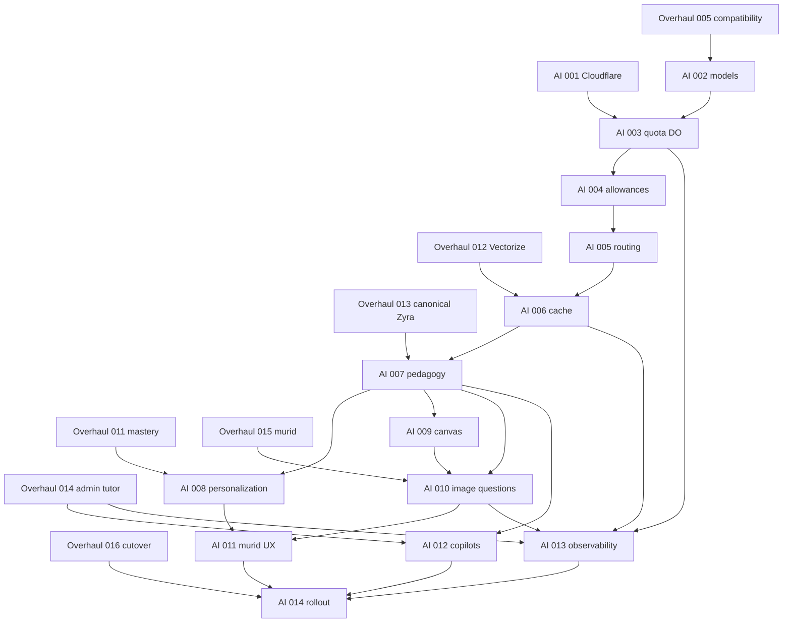

# Zyra AI System Overhaul

Generated with the `improve` skill on 2026-08-02. This program is isolated from the 16-plan Idea-centered system overhaul. It may run in parallel only where the write sets below are disjoint.

Planning snapshot: `03b68ba0e66ee90f41fe92886b15f81a7a36ec3c`

Target: staging only, using `.env.staging` plus Cloudflare staging resources. Production deployment is out of scope.

## Approved product decisions

1. The four Gemini keys belong to four different Google Cloud projects. Provider quota is tracked per project and model, then aggregated across four project slots.
2. Murid receive 20 provider-backed Zyra turns per Jakarta calendar day. Cache hits and deterministic actions do not consume that allowance. Abuse guards are 8 interactions per minute and 60 total interactions per day.
3. Tutor receive 50 provider-backed turns per Jakarta calendar day and 150 total interactions per day. Admin has no individual cap but remains constrained by global model pools and operational reserves.
4. `gemini-3.1-flash-lite` is the default text model. `gemini-3.5-flash` and `gemini-3.6-flash` are premium routes. `gemini-3.5-flash-lite` is quarantined until its health gate passes.
5. Admin Zyra is proposal-first. It may prepare a typed diff, but no mutation occurs without explicit confirmation, fresh authorization, precondition revalidation, idempotency, and an audit record.
6. New Cloudflare resources maximize the existing free tier: a SQLite-backed Durable Object, Analytics Engine, the existing staging KV, a new private R2 attachment bucket, a new 768-dimension canonical Vectorize index owned by Overhaul Plan 012, a separate 768-dimension semantic-cache index, and the existing AI Gateway.
7. Zyra accepts image questions through paste, drag and drop, mobile capture, and file attachment. Student images are private, sanitized, excluded from shared cache, and subject to the same assessment-safety policy as text.

## Verified infrastructure baseline

Read-only inventory on 2026-08-02 found:

- Wrangler `4.101.0` is authenticated and has Workers, KV, AI, and Vectorize write permissions.
- KV namespaces `zyx` and `zyx-staging` exist.
- R2 buckets `zyx` and `zyx-staging` exist.
- Vectorize indexes `zyx-edu` and `zyx-vectors-staging` exist at 1024 dimensions with cosine distance.
- `workers/vector-api/wrangler.toml` currently binds staging to `zyx-vectors-staging`.
- No Zyra control-plane Worker, Zyra quota Durable Object, Analytics Engine binding, private Zyra attachment bucket, 768-dimension canonical v2 index, or 768-dimension Zyra semantic-cache index is declared in the repository.
- `.env.staging` contains the staging KV namespace ID, Vectorize Worker settings, and the reviewed Plan 005 provider-router configuration. Other optional application services remain outside the bounded provider-router smoke scope.

The existing 1024-dimension Vectorize indexes are rollback-only inputs. Overhaul Plan 012 creates `zyx-vectors-staging-v2` at exactly 768 dimensions and rebuilds it from Turso with the fixed `canonical-content-v2` Gemini Embedding 2 profile. This program creates `zyx-zyra-cache-staging`, also at 768 dimensions, for semantic cache only. The two 768 indexes remain separate because their task instructions, vector IDs, metadata, authorization, and lifecycle differ. Cloudflare index dimensions are immutable, and vectors from different embedding profiles must never be compared or mixed.

## Manual operator setup

Most Cloudflare resources can be created by the executor through the authenticated Wrangler session. The operator must provide or confirm secrets because plans must never print or invent them.

Before Plan 001 remote deployment, the operator must:

1. Confirm the executor is authenticated to the intended Cloudflare account with `wrangler whoami`.
2. Provide a new random `ZYRA_CONTROL_PLANE_TOKEN` through interactive `wrangler secret put`, and place the same value in the ignored `.env.staging` or the hosted staging environment. Never commit it.
3. Ensure staging has `GEMINI_API_KEY`, `GEMINI_API_KEY_2`, `GEMINI_API_KEY_3`, and `GEMINI_API_KEY_4`. `GEMINI_API_KEY_1` may remain a temporary alias for the first key but must not create a fifth pool slot.
4. Ensure staging has `CF_AI_GATEWAY_URL` and `CF_AI_GATEWAY_TOKEN`. If staging is hosted outside the local machine, set them in that host's encrypted environment settings as well as `.env.staging`.
5. Provide non-secret project aliases `gemini-project-1` through `gemini-project-4`. Do not place raw project numbers in user-facing responses or Analytics Engine data.
6. Confirm that the staging retention policy for learner image attachments is 7 days. Plan 001 provisions `zyx-zyra-private-staging` without a public domain and applies the lifecycle rule. A longer production retention policy requires a separate privacy decision.

No manual dashboard creation is required for Analytics Engine. Its dataset is created on first write after the binding is deployed. Overhaul Plan 012 creates the new 768 canonical index. AI Plan 001 creates the separate 768 semantic-cache index, private R2 bucket, lifecycle rule, and Worker. If the authenticated Wrangler session is unavailable to the executor, the operator must perform the commands exactly as listed in those plans.

## Capacity policy

Provider limits are enforced per project slot, never by multiplying one shared counter:

| Model | Limit per project per day | Four-project total | Initial usable ceiling |
|---|---:|---:|---:|
| `gemini-3.1-flash-lite` | 500 | 2000 | 1800 |
| `gemini-3.5-flash-lite` | 500 | 2000 | 0 while quarantined |
| `gemini-3.5-flash` | 20 | 80 | 64 |
| `gemini-3.6-flash` | 20 | 80 | 48 until health gate, then 64 |
| `gemini-2.5-flash` | 20 | 80 | 64 |
| `gemini-2.5-flash-lite` | 20 | 80 | 64 |
| `gemini-embedding-001` | 1000 | 4000 | migration only |
| `gemini-embedding-2` | 1000 | 4000 | 3600 |

The usable ceiling is a safety policy, not a claim about provider billing. Cached requests do not create provider reservations. An ordinary murid turn performs at most one generative provider call. If premium capacity is unavailable, the router falls back to the default model instead of rejecting a valid murid request.

## Cross-program ownership rules

The Idea-centered overhaul remains the owner of canonical domain data:

- Overhaul Plan 011 owns mastery and confidence truth.
- Overhaul Plan 012 owns the new `zyx-vectors-staging-v2` canonical index, fixed `canonical-content-v2` 768 embedding profile, full Turso re-embedding, and Pinecone migration.
- Overhaul Plan 013 owns canonical retrieval, DB hydration, citation authorization, and active-assessment enforcement.
- Overhaul Plan 014 owns the admin and tutor workflow plus the mutation audit boundary.
- Overhaul Plan 015 owns murid routes and Tutorial PKA parity.
- Overhaul Plan 016 owns final Pinecone removal and staging cutover.

This Zyra program must not duplicate those responsibilities. It owns provider scheduling, quotas, semantic response caching, pedagogical orchestration, learner adaptation, visual interaction, private multimodal attachments, Zyra UI, and AI operations telemetry.

Only one executor may edit `db/schema.ts`, `lib/env.ts`, `package.json`, shared docs, `lib/tutor-rag.ts`, or `components/course/**` at a time. The root integrator serializes those files even when feature work is developed in parallel.

## Execution order and status

| Plan | Title | Priority | Depends on | May run during overhaul | Status |
|---|---|---|---|---|---|
| [001](001-cloudflare-control-plane-foundation.md) | Provision the staging Zyra control plane | P0 | Overhaul 002 | 003 through 011, staging mutations serialized | DONE |
| [002](002-model-registry-and-provider-adapters.md) | Establish verified model registry and adapters | P0 | Overhaul 005 | 006 through 011, must finish before Overhaul 013 | PARTIAL |
| [003](003-distributed-quota-coordinator.md) | Implement distributed project and model quota leases | P0 | 001, 002 contracts | 003 through 011, new Worker files only | DONE |
| [004](004-role-allowances-and-usage-ledger.md) | Enforce murid, tutor, and admin allowances | P0 | 003, Overhaul 005 | Only when no other schema writer runs | DONE |
| [005](005-health-aware-model-routing.md) | Integrate health-aware four-project routing | P0 | 002, 003, 004 | Must finish before Overhaul 013 | DONE |
| [006](006-multilayer-semantic-cache.md) | Build privacy-safe exact and semantic cache | P1 | 001, 003, 005, Overhaul 012 | After Overhaul 012, before or serialized with 013 | DONE |
| [007](007-pedagogical-zyra-harness.md) | Build the pedagogical Zyra harness | P0 | 005, 006, Overhaul 013 | After Overhaul 013 only | IN PROGRESS |
| [008](008-evidence-based-personalization.md) | Personalize from learner evidence | P1 | 004, 007, Overhaul 011 | Parallel with 009 if shared files are serialized | IN PROGRESS |
| [009](009-interactive-learning-canvas.md) | Deliver typed interactive learning visuals | P1 | 007 | Parallel with 008 | IN PROGRESS |
| [010](010-multimodal-image-questions.md) | Add private image questions to Zyra | P0 | 001, 002, 004, 005, 007, 009, Overhaul 013 and 015 | After Overhaul 015 only | IN PROGRESS |
| [011](011-murid-zyra-experience.md) | Integrate quota UI, highlight ask, attachments, and Zyra pet | P1 | 004, 007, 009, 010, Overhaul 015 | After Plan 010 | IN PROGRESS |
| [012](012-tutor-and-admin-copilots.md) | Add safe tutor and admin copilots | P1 | 007, Overhaul 014 | After Overhaul 014; may parallelize with Overhaul 015 | IN PROGRESS |
| [013](013-ai-operations-observability.md) | Add quota, key, cache, and quality observability | P1 | 003, 004, 005, 006, 010, Overhaul 014 | New ops route may parallelize with 012 if files differ | IN PROGRESS |
| [014](014-staging-evaluation-and-rollout.md) | Prove the complete system in staging | P0 gate | 001 through 013, Overhaul 016 | After all predecessors | BLOCKED |

Status values: `TODO`, `IN PROGRESS`, `DONE`, `BLOCKED`, or `REJECTED`. A blocked row must include the exact failed gate and evidence path.

Plan 001 evidence: `artifacts/zyra-ai/20260805-plan001-final/plan-001-result.json`.

Plan 002 evidence: local registry, adapter, embedding-profile, lint, typecheck, and mock gates pass. Real staging artifact: `artifacts/zyra-ai/20260805-plan002-real/plan-002-model-probe.json`; 40 masked requests produced 39 passes and one transient 504 for quarantined `gemini-3-flash-preview`. The approved one-request retry also returned the same transient 504: `artifacts/zyra-ai/20260805-plan002-retry-preview/plan-002-model-probe.json`. The 3.5 Flash-Lite release gate remains `insufficient_sample`, so Plan 002 is partial.

Plan 003 evidence: `artifacts/zyra-ai/20260807-plan003-local-harness-fix/plan-003-result.json` and `artifacts/zyra-ai/20260807-plan003-final/plan-003-result.json`. The Durable Object quota ledger, clock, privacy, transition, and fairness tests pass, the Worker Wrangler dry-run passes, and the staging Worker was deployed and verified with health 200, unauthorized diagnostics 401 JSON, authenticated diagnostics 200 JSON, and remote synthetic concurrency smoke with 60 accepted reservations, 40 expected quota rejections, 60 committed transitions, fairness spread 0, and zero synthetic provider calls. No secret or authenticated URL was written to evidence.

Plans 010 through 013 have local implementations, focused contracts, deterministic evaluations, and zero-provider synthetic staging smokes. Evidence is recorded in `artifacts/staging-overhaul/20260812-plan010-audit/plan-010-images.json`, `artifacts/staging-overhaul/20260812-plan011-audit/plan-011-murid.json`, `artifacts/staging-overhaul/20260812-plan012-audit/plan-012-copilots.json`, and `artifacts/staging-overhaul/20260812-plan013-audit/plan-013-operations.json`. Their public flags remain off. Remote parity, human review, and live provider matrix evidence are not claimed.

Plan 014 was run in synthetic-users-only mode and correctly produced `BLOCKED`. The result records a dirty worktree, absent Plan 001–006 artifact copies, the pending Plan 007 active-session, remote shadow, and maintainer review gates, and the fact that no live staging matrix was run: `artifacts/staging-overhaul/20260812-plan014-audit/plan-014-result.json`.

Plan 004 completed: the focused allowance suite, root typecheck, additive `0059_tricky_tag.sql` staging migration, staging-backed application canary, legacy preservation check, and strict reconciliation all pass. The canary recorded accepted and rejected requests, cache hit zero-provider accounting, idempotent commit and refund, authenticated current-user summary, and zero provider calls. The feature flag was enabled only in the canary process and is off afterward. Evidence: `artifacts/staging-overhaul/20260807-plan004-allowance/plan-004-result.json` and `artifacts/staging-overhaul/20260807-plan004-app-canary-v3/plan-004-application-canary.json`.

Plan 005 completed: the server-only control-plane client, application/provider lease lifecycle, deterministic route classification, project fallback, AI Gateway metadata, quarantine protection, focused contracts, lint, and root typecheck pass. The paced staging smoke completed 40 of 40 provider requests successfully across four project slots, used only `gemini-3.1-flash-lite`, recorded zero quarantined traffic, and reconciled 40 committed application leases with zero active control-plane leases. A prior unpaced run recorded seven application per-minute allowance rejections and no provider failure; the paced rerun is the accepted gate evidence. Evidence: `artifacts/zyra-ai/20260807-plan005-provider-router-paced-v1/plan-005-provider-router.json` and the prior diagnostic `artifacts/zyra-ai/20260807-plan005-provider-router-real-v2/plan-005-provider-router.json`.

Plan 006 completed: exact cache identity, privacy-safe shared scaffolds, AI Gateway key sharing, Durable Object single-flight, the 900-write budget, semantic profile isolation, version invalidation, and rollback are implemented. The local focused suite passed 17 tests, the 200-pair semantic calibration passed with zero false reuse and 100 percent precision, and the staging smoke produced 1 leader plus 49 followers, 1 strict semantic match, zero cache provider units, zero real provider calls, and a 10-write observed budget claim within the 900-write ceiling. The staging Worker was verified at deployment version `plan-006`; the separate `zyx-zyra-cache-staging` resource has the required metadata indexes. Evidence: `artifacts/zyra-ai/20260807-plan006-preflight/plan-001-preflight.json`, `artifacts/zyra-ai/20260807-plan006-semantic-calibration/plan-006-semantic-calibration.json`, and `artifacts/zyra-ai/20260807-plan006-cache-smoke-v10/plan-006-cache-smoke.json`.

Plan 007 is partial and local-ready: the deterministic state machine, typed response contract, citation and assessment validators, safe composition, one-call prompt contract, tutor integration, masked canonical failure boundary, bounded staging shadow runner, local review page, strict human evidence validator, and zero-provider startup diagnostics are implemented. Focused tests pass with 50 tests and 174 assertions. The 40-case machine evaluation passes with 100 percent state and checkpoint compliance, zero active-assessment leaks, zero unsupported claims, zero invalid citations, zero pipeline-language leaks, and zero provider calls. The fixture smoke validates 40 of 40 cases. Canonical and tutor runtime imports now use a scoped Zyra env contract instead of full application env validation. The latest read-only staging diagnostic reaches the database but stops at `session_context` because the dedicated identity has no active session; it records zero provider calls and zero writes. One controlled remote retry and maintainer review remain pending. Evidence: `artifacts/zyra-ai/20260807-plan007-pedagogy-eval/plan-007-pedagogy-eval.json`, `artifacts/staging-overhaul/20260808-plan007-local-shadow-v2/plan-007-pedagogy-shadow.json`, `artifacts/staging-overhaul/20260808-plan007-startup-diagnostics-v3/plan-007-pedagogy-startup-diagnostics.json`, and the latest masked diagnostic artifact from 2026-08-12.

Plan 008 implementation is in progress. The deterministic allowlist, profile and event schema, expiry and reset behavior, explicit preference override, profile-free shared-scaffold assertion, authenticated API boundary, additive migration `0067_zyra_continuation.sql`, 18 focused tests, and zero-provider synthetic smoke are present. Migration 0067 was reconciled in staging on 2026-08-12 with 164 tables, 7 additive tables, and zero foreign-key violations. The functional rollout gate remains pending. Evidence: `artifacts/staging-overhaul/20260812-plan008-audit/plan-008-personalization.json`.

Plan 009 local implementation is in progress. Typed canvas contracts, bounded capability metadata, safe expression AST evaluation, local parameter controls, accessible fallback rendering, typed response-to-cache-to-chat propagation, legacy visual compatibility, focused tests, a 16-fixture evaluation, and a zero-provider synthetic smoke are present. Remote staging review and rollout remain pending. Evidence: `artifacts/staging-overhaul/20260812-plan009-audit/plan-009-canvas.json` and the current canvas chat propagation contract test.

## Parallel orchestration

## Common executor rules

Every plan is self-contained, but these program invariants always apply:

1. Read `AGENTS.md`, `db/schema.ts`, and `lib/env.ts` before implementation.
2. Read the installed Next.js 16 guide under `node_modules/next/dist/docs/` before changing a page, route, server action, or caching behavior.
3. All remote commands load `.env.staging` and run the staging identity guard before and after the remote action.
4. Never print secrets, full authenticated URLs, raw student conversations, or raw user IDs in artifacts.
5. All new user-visible behavior is behind the plan's `FEATURE_*` flag. Missing or `0` means invisible.
6. Database changes use expand, migrate, verify, switch, then later contract. Existing usage, chat, attempt, and analytics records remain readable.
7. After each meaningful edit batch, run `bun run lint` and the narrowest tests. Final local gates are targeted tests, `bun run typecheck`, and `git diff --check`.
8. Do not run a production migration or deploy.
9. Do not use em dash or en dash characters in changed files. Use the brand spelling `Zyx`.
10. Each remote plan produces `artifacts/zyra-ai/<runId>/plan-NNN-result.json` from a script. Handwritten success evidence is invalid.

## Program-level release gates

The program is not ready when code merely compiles. Plan 014 must prove all of the following:

- Provider quota oversubscription: 0 in concurrency tests and staging telemetry.
- Active-assessment answer leaks: 0.
- Invalid or stale citations: 0.
- Cross-user shared-cache data leaks: 0.
- Cross-course or cross-policy semantic cache reuse: 0.
- Active canonical vectors with a dimension other than 768: 0.
- Cross-model or cross-profile vector mixing: 0.
- Active reads or writes to the preserved 1024 indexes after cutover: 0.
- Cross-user image access or cache reuse: 0.
- Accepted attachments that retain EXIF or GPS metadata: 0.
- Multimodal requests larger than the provider's 20 MB inline request limit: 0.
- Active-assessment answer leaks caused by an uploaded screenshot: 0.
- Murid allowance accuracy: 100 percent across reserve, commit, refund, cache hit, midnight reset, retry, and timeout cases.
- Default chat p95 latency: at most 5 seconds excluding first cold start.
- Cache-hit p95 latency: at most 800 ms.
- Health fallback succeeds within one user-visible turn for at least 99 percent of injected provider failures.
- All required Tutorial PKA Zyra journeys pass with historical data preserved.
- Serious or critical accessibility violations on changed surfaces: 0.
- Rollback rehearsals restore the previous runtime without deleting chats, leases, usage events, cache objects, or canonical data.

## Considered and rejected

- Reuse or mutate `zyx-vectors-staging`: rejected because its 1024-dimension configuration is immutable and it must remain unchanged for rollback.
- Force Gemini Embedding 2 to keep producing 1024-dimensional canonical vectors: rejected. Both new systems follow the approved 768-dimensional profile and rebuild into new indexes.
- Combine canonical retrieval and semantic cache in one 768 index: rejected because their instructions, vector identities, metadata, authorization, and lifecycle differ.
- Treat four API keys as one aggregate counter: rejected because quota and health failures occur per project and model.
- Cache personalized final answers across murid: rejected because it risks cross-user leakage and pedagogical mismatch.
- Let admin Zyra directly execute mutations: rejected because a stale or malformed model output could cause a catastrophic configuration change.
- Rebuild existing KO, question, material, analytics, or canonical retrieval pipelines: rejected because the repository marks them as completed and the 16-plan overhaul owns their domain migration.
